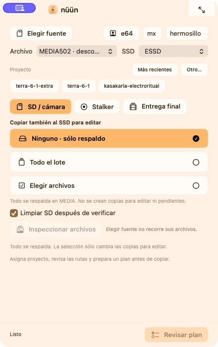

# nüün

**Una multiherramienta para creadores:** organiza archivos, almacenamiento y pequeños flujos que conectan el trabajo creativo con sus herramientas y dispositivos.

nüün es la app para macOS de este repositorio, `n-creator-utils`. Hoy su área más desarrollada es **media**: ingresar, respaldar y preparar video, audio, fotos y capturas para trabajar. También hay utilidades de línea de comandos para música y audio; a futuro, el proyecto puede crecer hacia dispositivos, iluminación y automatización.

> **En desarrollo.** El motor de media y la app tienen pruebas y una instalación local de desarrollo, pero aún faltan validación física, endurecimiento y distribución. Consulta el [estado actual](docs/STATUS.md) y los [requisitos para una release](docs/release.md).



*La vista compacta permite preparar el ingreso y revisar las opciones de respaldo.*

## Media y almacenamiento

Desde nüün o la CLI puedes revisar una fuente, asignar archivos a proyectos y preparar un plan antes de ejecutarlo. El flujo principal cubre:

- **Ingreso y respaldo:** copia a los destinos elegidos y verifica su contenido con SHA-256. La limpieza de la fuente sigue la política del plan y sólo ocurre después de verificar los destinos requeridos.
- **Copias de trabajo:** prepara material para edición en un SSD o registra una entrega pendiente desde el archivo. El respaldo sin copia de trabajo requiere una decisión explícita por operación.
- **Biblioteca y espacio:** consulta el catálogo, recupera o entrega archivos, revisa pendientes y prepara auditorías y planes de liberación de espacio.
- **Capturas Stalker:** reúne sesiones finalizadas en una bandeja, conserva sus bundles completos y permite asignarlas a proyectos. La liberación del original depende de las verificaciones y de las dependencias de edición.

La app ofrece modos compacto, selección y completo, con vista previa de archivos, actividad, biblioteca y ajustes. La CLI y la app usan el mismo motor de planificación y transferencia.

[Conocer la app](docs/features/nuun-window.md) · [Guía de uso y almacenamiento](docs/operations.md) · [Política de copias](docs/features/replication-policy.md)

## Un ecosistema de herramientas

nüün se ocupa de almacenamiento y coordinación; cada herramienta conserva la responsabilidad de sus propios datos:

- **Stalker** graba sesiones y mantiene sus manifiestos. nüün puede descubrir y archivar sesiones terminadas.
- **[Clipper](https://github.com/nu9ve/clipper)** gestiona edición y colas. Hay coordinación para entregar y reenlazar archivos mediante su CLI; las pruebas de integración usan datos temporales y la aceptación física sigue pendiente.
- **Final Cut** participa en la edición manual. **Atlas** trabaja con información geoespacial e imágenes de dron. Sus flujos requieren revisión humana y no se presentan como integraciones automáticas completas.

Las integraciones con Stalker y Clipper son opcionales para el funcionamiento básico de media. [Contratos y estado de adopción](docs/contracts/README.md).

## Más utilidades y hacia dónde puede crecer

El repositorio también conserva comandos para **descargar video, canciones o samples** y **separar audio en stems**. Son flujos anteriores con configuración y dependencias propias; todavía no comparten todo el ciclo del catálogo de media. [Comandos y límites](docs/commands.md#descargas-y-stems) · [Configuración](docs/configuration.md).

Hay código experimental para **controladores MIDI**. Iluminación, IoT, Raspberry Pi y conexiones entre dispositivos son parte de la visión para explorar, no funciones integradas de la app hoy. La intención es que nüün pueda reunir utilidades distintas sin que cada idea tenga que convertirse en una función de media.

## Empezar

Para explorar la CLI desde el código necesitas Python 3.9 o posterior:

```sh
python3 -m venv .venv
source .venv/bin/activate
python -m pip install -e .
nu9ve --help
nu9ve media --help
```

Para compilar e instalar la app localmente se necesita macOS 14+ y Swift 6. Antes de operar con archivos, registra tus destinos y revisa el plan y sus opciones de limpieza. La [guía operativa](docs/operations.md) explica la instalación, los discos, el respaldo y la recuperación. Algunas utilidades de audio y video requieren herramientas adicionales.

El importador anterior sigue disponible como `legacy-save` y tiene garantías distintas; consulta la [referencia de comandos](docs/commands.md) antes de usarlo.

## Documentación

- [Contexto del proyecto](docs/CONTEXT.md): flujo actual y decisiones importantes.
- [Estado y evidencia](docs/STATUS.md): implementación, pruebas y límites pendientes.
- [Plan de trabajo](PLAN.md): prioridades y próximos pasos.
- [Operación e instalación](docs/operations.md): app, CLI, discos y recuperación.
- [Desarrollo](docs/development.md) · [Contratos entre apps](docs/contracts/README.md) · [Índice completo](docs/README.md).
