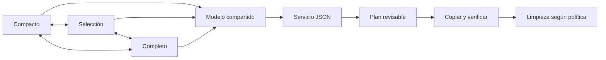

# nüün · ventana y flujo de ingreso

Estado/evidencia vigente: [STATUS](../STATUS.md). Operación: [operations](../operations.md#app-de-desarrollo-y-launcher). Esta página describe responsabilidades y límites, no duplica los release gates.

## Ingreso vigente · 2026-11-05

[Entrada → Flujo → Resultado](../contracts/ingest-flow-v1.md), en los tres tamaños. Fuente y contenido están juntos; destinos y revisión también. El botón final autoriza el documento mostrado y su limpieza verificada, sin otro modal. Selección ofrece más espacio, pero ya no es requisito para editar contenido en compacto. Soporte de cámara incluido y agrupado; detalle por bundle/archivo desplegable.

## Una ventana, tres presentaciones

`WindowRoot` mantiene el mismo `Model` y un solo `NSWindow`: compacto (440×700 pt), selección (780×820) y completo (1180×900, redimensionable/pantalla completa). El tamaño se limita al área visible. La esquina permite expandir/compactar; el contenido también puede revisarse dentro de compacto. Proyecto, fuente, selección por unidad y plan viven en el modelo, no en la vista. El cambio anima el frame y respeta Reduce Motion; reactivar desde el launcher conserva el modo visible. Las dimensiones son preferencias de presentación, no coordenadas de negocio.

## Compacto flotante y montaje · 2026-11-06

Compacto permanece por encima de ventanas normales incluso al cambiar de app (`floating`, sin ocultación por desactivación); selección/completo y fullscreen vuelven al nivel normal. Cerrar lo oculta y mantiene el proceso en menubar. Una tarjeta elegible ofrece compacto automáticamente con destinos online y sin job activo. Activado por defecto; el opt-out de Ajustes se conserva. No hay copia, limpieza ni discovery profundo por abrir la ventana. [Contrato](../contracts/ingest-flow-v1.md#barra-y-montaje).

## Carga y resúmenes

Montar una tarjeta o cambiar de modo no inicia una lectura profunda por defecto. Elegir manualmente una SD, «Inspeccionar», «Preparar lote» y continuar a Flujo cuando falta contenido solicitan discovery; la inspección automática es una preferencia explícita. Revisar un plan ejecuta el planner común y su validación. Una clave fuente/tipo/archivo evita repetir el escaneo al cambiar de modo; una petición cancelada o antigua no reemplaza los datos actuales. IDs de generación impiden que una respuesta cancelada de la misma fuente cierre el loader de una petición nueva. El lector utiliza un cliente independiente: cancelar una inspección no cancela una transferencia. No hay sondeo periódico en reposo. Compacto usa la misma inspección y muestra el contenido sin exigir otro tamaño. Montaje/wake siguen sus gates de destinos registrados.

Las miniaturas visibles cargan bajo demanda con hasta cuatro peticiones activas y caché de 24 MB/160 entradas. Para videos, AVFoundation pide un fotograma cerca de la mitad; al mover el cursor por la miniatura se muestrean seis tramos, con demora breve y caché por tramo. Las imágenes siguen usando Quick Look. El grid presenta imágenes y metadatos sin tarjeta de fondo por archivo. Los contadores representan unidades/pares/bundles; no siempre equivalen al número de archivos físicos. Dron/360 sólo se muestran cuando se clasifican explícitamente; no se interpreta toda marca DJI como dron. El resumen previo muestra tipos, evidencia de cámara y raíz de respaldo; las rutas definitivas, con fecha/modelo/clasificación, pertenecen al plan. EXIF/registro persistente de cámaras sigue pendiente.

Stalker muestra preview del video de pantalla, fecha, duración y pistas cuando el manifiesto lo permite; sesiones activas se omiten. En Inicio, Enter guarda sólo si el proyecto cambió y un clic en uno de los cinco recientes lo asigna; un proyecto existe como borrador desde que una sesión lo nombra, así que aparece enseguida en las demás filas, en Ingreso y en Biblioteca → Proyectos. En Ingreso, cada sesión del grid puede tener proyecto propio; el campo del lote y las sugerencias rápidas rellenan unidades que no tengan una asignación específica. Las bibliotecas actual y anteriores se descubren por el registro de Stalker, y `~/Movies/Stalker` y `~/Downloads` cuentan si tienen sesiones; Ajustes → Capturas permite añadir una carpeta manual. La UI las presenta como un solo Stalker y sólo nombra carpetas cuando hay sesiones en más de una. En una biblioteca compartida sólo se visitan bundles `.stalker` de su primer nivel (o un bundle elegido directamente); archivos/editor projects ajenos no se recorren. Discovery y planner comparten el filtro de sesiones ya archivadas en el destino seleccionado.

En lotes Stalker, el proyecto del lote queda como fallback para sesiones sin proyecto. Si todas ya tienen uno, el campo global puede quedar vacío; el resumen enumera los proyectos/rutas incluidos. Las tarjetas ponen fecha, duración, pistas y perfil sobre el video para ahorrar altura; proyecto asignado queda en una línea con lápiz, y las sugerencias rápidas aparecen en la sesión sin asignar o al editarla. Cambiar asignaciones invalida un plan revisado.

La barra superior es un `NSToolbar` nativo (estilo compacto unificado) en el mismo renglón que los controles de la ventana: nombre, pestañas Inicio/Ingreso/Flujos/Biblioteca, discos registrados con su espacio libre (ceden lugar antes que las pestañas al angostar y abren Discos) en completo, con Archivos, Discos y Actividad como subtabs de Biblioteca (sólo iconos en anchos pequeños), ajustes y control de modo. En pantalla completa la ventana pide ocultar sólo la barra de menús, no la toolbar, así que las pestañas siguen visibles sin revelar la barra de menús (corrige el reporte del 2026-10-29). En macOS 26 el ítem no usa la burbuja automática de la toolbar; las pestañas, la barra de pasos y los pies de acción flotantes usan Liquid Glass y en macOS 14–15 superficies opacas. Ajustes es una ventana propia (⌘,). Atajos: ⌘1 Inicio, ⌘2 Ingreso, ⌘3 Archivos, ⌘4 Actividad, ⌘5 Discos, ⌘\\ modo, ⌘[ / ⌘] pasos, ⌘R revisar plan, ⌘↩ ejecutar (con confirmación), ⌘E expulsar, ⌘N nueva ingesta. Cada modo recuerda su último marco mientras quepa en pantalla. La revisión con estado aislado no sustituye la matriz de pantallas/Spaces/accesibilidad.

## Ingreso por pasos (2026-10-29)

Ingreso es un flujo de cinco pasos visibles en una barra superior: **Fuente y proyecto → Contenido → Destinos → Revisar → Copiar**. Se puede saltar a cualquier paso; lo único que bloquea «Revisar plan» es lo que el planner necesita (fuente, proyecto del lote o de cada sesión, disco de respaldo, clasificar DJI y, con «Elegir archivos», marcar alguno). Compacto, selección y completo usan el mismo flujo con distinta densidad; al abrir Contenido desde compacto la ventana pasa a selección.

- **Rápido** (por defecto): fuente + proyecto y luego revisar; destinos se resumen con «Cambiar». **Guiado**: recorre todos los pasos. Se elige en Ajustes → Ingreso, junto con leer el contenido al elegir una SD (desactivado: elegir fuente no recorre archivos).
- **Fuente**: SDs conectadas como tarjetas con familia detectada, uso/capacidad, flujo recomendado y último proyecto usado con esa tarjeta (sugerencia); un solo Stalker y «Otra carpeta…». No hay selector de tipo: cada fuente lo sabe, y una carpeta es Stalker si contiene bundles. La limpieza sólo se activa en una SD montada.
- **Contenido**: grilla con filtros por tipo (incluye «DJI sin clasificar»), selección estándar (clic, ⌘, ⇧), vista rápida con espacio o doble clic y panel para asignar proyecto, perfil, cámara, país y copia al SSD a la selección o a todo lo visible.
- **Revisar** muestra el plan; **Ejecutar…** abre una hoja que nombra copias, destinos y la limpieza/liberación antes de continuar. «Sólo respaldo» también se confirma en una hoja.
- **Copiar** muestra progreso medido por fase y destino; mientras tanto se puede navegar por Biblioteca, Actividad e Inicio (sólo se bloquea la edición de esa ingesta). Al terminar ofrece expulsar, abrir biblioteca/actividad o una nueva ingesta.

La app lee el estado en reposo con una sola llamada `snapshot` a un lector persistente de sólo lectura; mutaciones siguen un proceso por petición ([contrato](../contracts/media-library-v1.md#fuentes-y-expulsión-local-2026-10-27)). Las miniaturas se guardan decodificadas.

## Proyectos, avisos y finales (2026-11-01)

Biblioteca → **Proyectos** es el subtab por defecto: referencias y conteos, no archivos. La etapa sale de recibos y sesiones; pausar o terminar es una decisión de la persona y no borra nada. Filtros: en progreso (borradores y lo pendiente, sin pausados), respaldados, terminados y todos. Renombrar actualiza catálogo, sesiones y valores por defecto; las carpetas copiadas conservan su nombre y el nombre anterior sigue resolviendo como alias. «Subir a recientes» ordena los proyectos rápidos de toda la app, que excluyen los terminados.

Cada aviso de **Requiere atención** se descarta en Inicio o Actividad. Descartar sólo apaga el recordatorio: el job conserva estado y acciones, y se puede volver a avisar.

**Finales sin respaldar** es de sólo lectura: compara nombre y tamaño contra el mismo perfil en el respaldo porque ambos discos ordenan distinto, en un proceso propio, al abrir Inicio y como mucho cada 15 minutos. Requiere ambos discos conectados. No infiere proyecto y todavía no copia; ver [PLAN](../../PLAN.md).

## Perfiles y ubicaciones

Los perfiles guardados tienen ID, etiqueta, carpeta relativa de raws y discos sugeridos. Elegirlos en la app aplica esas sugerencias; el usuario revisa siempre los destinos reales. La carpeta se aplica tanto a UI como CLI por el planner común. Un job tiene un destino de archivo y como máximo un SSD activo: varios SSD por perfiles dentro del mismo job no están implementados.

`profile_routes` congela las carpetas usadas en el digest/recibo del plan; cambiar un perfil no cambia copias anteriores ni un plan revisado. El registro de perfiles/etiquetas/sugerencias vive en el catálogo local y requiere la política de backup de metadata pendiente; los recibos conservan la ruta de cada job, no restauran toda la configuración.

## Ingreso · selección de fuente y expulsión (2026-10-27)

Histórico: el layout de este apartado lo reemplaza «Ingreso por pasos»; las reglas de expulsión y de plan siguen vigentes.

El encabezado completo usa un renglón: SD/fuente y expulsión a la izquierda, perfil/país/ciudad al centro, archivo y SSD a la derecha. Compacto/selección usan dos. El selector ofrece SDs removibles conectadas y bibliotecas Stalker configuradas; «Otra…» abre el selector nativo de carpeta (incluye navegación por ruta). La consulta de montajes no recorre media ni cambia los gates de popup/destinos. Elegir una fuente no inicia discovery.

Tres proyectos recientes son badges directos; «Más recientes» ofrece el resto y «Otro…» revela texto manual. El proyecto del lote rellena sólo unidades sin proyecto propio. La app conserva el documento original del plan para ejecutar sin reserializar la revisión ([contrato](../contracts/media-library-v1.md#documento-de-plan-para-clientes-nativos-2026-10-27)). Stalker requiere inspección antes de planear para incorporar las asignaciones de sesión; «Preparar lote» ya solicita esa inspección. Debajo queda la política `Ninguno`/`Todo el lote`/`Elegir archivos`, trabajo diferido y limpieza después de verificar. «Revisar plan» permanece como acción primaria del pie fijo.

La expulsión es explícita, antes o después del job, sólo para una SD removible elegida desde los montajes conocidos. No se ofrece para archivo/SSD ni para imágenes de disco. La UI la deshabilita durante operación o inspección; el servicio comparte el bloqueo interproceso de mutaciones de CLI/app y vuelve a validar identidad, raíz de montaje y separación física de destinos. Un remount de destino se compara con sus stores actuales. No fuerza desmontaje ni expulsa automáticamente; un timeout informa estado incierto y exige refrescar antes de retirar. Swift nunca ejecuta diskutil. Boundary: [contrato local](../contracts/media-library-v1.md#fuentes-y-expulsión-local-2026-10-27).

El grid reparte el ancho disponible entre las unidades de la fila, mantiene proporción 16:9 y mejora contraste de overlays. La caché distingue el centro del video de las seis muestras del hover y reutiliza resultados obtenidos mientras otra petición esperaba turno. No hay todavía benchmark de mejora de transferencia ni de tarjetas enormes. Evidencia visual/fixtures y aceptación física pendiente: [STATUS](../STATUS.md).

## Bandeja y siguientes pasos

Bandeja reúne tarjetas sugeridas, Stalker terminado pendiente, trabajo diferido y operaciones bloqueadas. «Preparar lote» abre una biblioteca para planear en una sola revisión todas sus sesiones Stalker pendientes, asignando proyecto por unidad. Si las sesiones están en varias bibliotecas raíz, se prepara un plan por raíz; no hay todavía una transacción global entre ellas ni se aplican planes en serie. Acciones contextuales de Ingreso, Archivos, Discos e Inicio quedan en un pie fijo; Ajustes conserva sus botones junto a cada opción. Tras verificar el respaldo, el mismo plan de ingreso revisa Clipper, hace relink mediante su CLI/ACK y libera el original Stalker si no hay bloqueos. Ajustes → Capturas permite conservarlo para una liberación manual posterior desde Inicio o Discos. Si falla una compuerta, se conserva el original. [Operación y límites](../operations.md#bandeja-stalker-proyectos-y-liberar-espacio).

Pendientes de aceptación: reconexión real/popup, bibliotecas y tarjetas enormes, pérdidas de eventos, benchmarks de CPU/memoria, fullscreen/Spaces en diferentes pantallas y matriz de accesibilidad/contraste. La instalación usa runtime Python externo y no implica release portable/notarizado.
