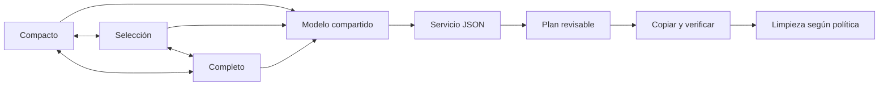

# nüün · ventana y flujo de ingreso

Estado/evidencia vigente: [STATUS](../STATUS.md). Operación: [operations](../operations.md#app-de-desarrollo-y-launcher). Esta página describe responsabilidades y límites, no duplica los release gates.

## Una ventana, tres presentaciones

`WindowRoot` mantiene el mismo `Model` y un solo `NSWindow`: compacto (440×700 pt), selección (780×820) y completo (1180×900, redimensionable/pantalla completa). El tamaño se limita al área visible. La esquina permite expandir/compactar; elegir archivos desde compacto abre selección directamente. Proyecto, fuente, selección por unidad y plan viven en el modelo, no en la vista. El cambio anima el frame y respeta Reduce Motion; reactivar desde el launcher conserva el modo visible. Las dimensiones son preferencias de presentación, no coordenadas de negocio.

## Carga y resúmenes

Al entrar en selección/completo, la fuente elegida se inspecciona automáticamente. Una clave fuente/tipo/archivo evita repetir el escaneo al cambiar de modo; una petición cancelada o antigua no reemplaza los datos actuales. IDs de generación impiden que una respuesta cancelada de la misma fuente cierre el loader de una petición nueva. El lector utiliza un cliente independiente: cancelar una inspección no cancela una transferencia. No hay sondeo periódico en reposo. Compacto evita esa carga hasta expandir o elegir archivos. Montaje/wake siguen sus gates de destinos registrados.

Las miniaturas visibles cargan bajo demanda con hasta cuatro peticiones activas y caché de 24 MB/160 entradas. Para videos, AVFoundation pide un fotograma cerca de la mitad; al mover el cursor por la miniatura se muestrean seis tramos, con demora breve y caché por tramo. Las imágenes siguen usando Quick Look. El grid presenta imágenes y metadatos sin tarjeta de fondo por archivo. Los contadores representan unidades/pares/bundles; no siempre equivalen al número de archivos físicos. Dron/360 sólo se muestran cuando se clasifican explícitamente; no se interpreta toda marca DJI como dron. El resumen previo muestra tipos, evidencia de cámara y raíz de respaldo; las rutas definitivas, con fecha/modelo/clasificación, pertenecen al plan. EXIF/registro persistente de cámaras sigue pendiente.

Stalker muestra preview del video de pantalla, fecha, duración y pistas cuando el manifiesto lo permite; sesiones activas se omiten. En Bandeja, las tres sugerencias más recientes quedan como botones directos. En Ingreso, cada sesión del grid puede tener proyecto propio; el campo del lote y las sugerencias rápidas rellenan unidades que no tengan una asignación específica. Las bibliotecas actual y anteriores se descubren por el registro de Stalker; Ajustes → Capturas permite añadir una carpeta manual. En una biblioteca compartida sólo se visitan bundles `.stalker` de su primer nivel (o un bundle elegido directamente); archivos/editor projects ajenos no se recorren. Discovery y planner comparten el filtro de sesiones ya archivadas en el destino seleccionado.

En lotes Stalker, el proyecto del lote queda como fallback para sesiones sin proyecto. Si todas ya tienen uno, el campo global puede quedar vacío; el resumen enumera los proyectos/rutas incluidos. Las tarjetas ponen fecha, duración, pistas y perfil sobre el video para ahorrar altura; proyecto asignado queda en una línea con lápiz, y las sugerencias rápidas aparecen en la sesión sin asignar o al editarla. Cambiar asignaciones invalida un plan revisado.

La ventana completa presenta las pestañas centradas en un accesorio superior de 50 pt, con el estado a la izquierda y el control de modo en el extremo derecho. En compacto/selección se muestra “Ingreso” y expandir en ese mismo renglón. El título del sistema conserva la marca junto a los controles de ventana; el contenido ya no duplica logo ni navegación en una segunda fila. El accesorio permanece visible al entrar a pantalla completa; falta aceptación visual de alineación, recorte y contraste.

## Perfiles y ubicaciones

Los perfiles guardados tienen ID, etiqueta, carpeta relativa de raws y discos sugeridos. Elegirlos en la app aplica esas sugerencias; el usuario revisa siempre los destinos reales. La carpeta se aplica tanto a UI como CLI por el planner común. Un job tiene un destino de archivo y como máximo un SSD activo: varios SSD por perfiles dentro del mismo job no están implementados.

`profile_routes` congela las carpetas usadas en el digest/recibo del plan; cambiar un perfil no cambia copias anteriores ni un plan revisado. El registro de perfiles/etiquetas/sugerencias vive en el catálogo local y requiere la política de backup de metadata pendiente; los recibos conservan la ruta de cada job, no restauran toda la configuración.

## Ingreso compacto · siguiente mejora solicitada (2026-10-27)

La captura de pantalla actual muestra la ruta de origen como un campo de texto siempre visible y largo; el proyecto, perfil, país/ciudad, archivo y SSD de trabajo quedan en filas separadas. Rediseñar el comienzo de Ingreso para que primero resuelva una SD conectada o una fuente configurada, sin pedir escribir paths en el caso común.

- El selector de origen enumera tarjetas SD/cámara conectadas y fuentes configuradas con nombre, volumen y estado. Reusa los gates actuales de inserción/destinos: sugerir un montaje no inicia un deep scan; inspeccionarlo requiere selección manual. «Otra…» abre un selector de carpeta/ruta sólo para fuentes fuera de la lista; el campo editable no ocupa el espacio por defecto.
- En el encabezado compacto, agrupar en un máximo de dos renglones seis controles: origen, perfil general, país, ciudad, disco de archivo y SSD de trabajo. Mantener rol y volumen legibles, sin confundir perfil con proyecto.
- Mostrar los tres proyectos recientes como badges seleccionables y «Otro…» para abrir la entrada manual. El proyecto elegido para el lote sólo rellena unidades sin proyecto individual; nunca sobrescribe asignaciones específicas de Stalker.
- Debajo dejar la política de copia al SSD (`Ninguno`, `Todo el lote`, `Elegir archivos`) y la opción de limpiar/liberar el origen después de verificar. Mantener el resumen y las acciones del plan revisable en el pie fijo; «Revisar plan» es la acción primaria a la derecha.
- Agregar acción explícita para expulsar/desmontar una SD desde Ingreso, disponible antes de iniciar o después de completar una operación. Deshabilitarla mientras el job la use como origen; no expulsar automáticamente durante ni al completar una transferencia. No ofrecerla para MEDIA o el SSD de trabajo. El servicio actual aún no tiene una operación de expulsión: antes de implementarla, revisar identidad/montaje en `media/volumes.py` y agregar una operación estrecha en el boundary compartido, sin invocar `diskutil` desde Swift ni exponer expulsión genérica de volúmenes.

Aceptación: al abrir Ingreso, la tarjeta conectada se elige desde una lista y no se necesita editar una ruta; los proyectos recientes son seleccionables; «Otro…» permite una fuente manual; origen/perfil/país/ciudad/archivo/SSD ocupan hasta dos renglones en selección y completo; la política de copia queda debajo y se entiende que verificar precede a limpiar. Expulsión funciona antes y después de un job y se bloquea durante éste. Validar primero con fixtures y estado aislado; inspeccionar visualmente modos compacto/selección/completo, sin operar SDs personales como prueba automatizada.

## Bandeja y siguientes pasos

Bandeja reúne tarjetas sugeridas, Stalker terminado pendiente, trabajo diferido y operaciones bloqueadas. «Preparar lote» abre una biblioteca para planear en una sola revisión todas sus sesiones Stalker pendientes, asignando proyecto por unidad. Si las sesiones están en varias bibliotecas raíz, se prepara un plan por raíz; no hay todavía una transacción global entre ellas ni se aplican planes en serie. Acciones contextuales de Ingreso, Biblioteca, Actividad, Bandeja y Espacio quedan en un pie fijo; Ajustes conserva sus botones junto a cada opción. Tras verificar el respaldo, el mismo plan de ingreso revisa Clipper, hace relink mediante su CLI/ACK y libera el original Stalker si no hay bloqueos. Ajustes → Capturas permite conservarlo para una liberación manual posterior desde Espacio. Si falla una compuerta, se conserva el original. [Operación y límites](../operations.md#bandeja-stalker-proyectos-y-liberar-espacio).

Pendientes de aceptación: reconexión real/popup, bibliotecas y tarjetas enormes, pérdidas de eventos, benchmarks de CPU/memoria, fullscreen/Spaces en diferentes pantallas y matriz de accesibilidad/contraste. La instalación usa runtime Python externo y no implica release portable/notarizado.
