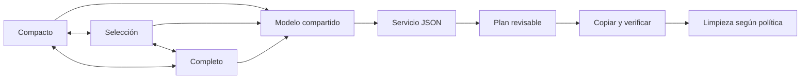

# nüün · ventana y flujo de ingreso

Estado/evidencia vigente: [STATUS](../STATUS.md). Operación: [operations](../operations.md#app-de-desarrollo-y-launcher). Esta página describe responsabilidades y límites, no duplica los release gates.

## Una ventana, tres presentaciones

`WindowRoot` mantiene el mismo `Model` y un solo `NSWindow`: compacto (440×700 pt), selección (780×820) y completo (1180×900, redimensionable/pantalla completa). El tamaño se limita al área visible. La esquina permite expandir/compactar; elegir archivos desde compacto abre selección directamente. Proyecto, fuente, selección por unidad y plan viven en el modelo, no en la vista. El cambio anima el frame y respeta Reduce Motion; reactivar desde el launcher conserva el modo visible. Las dimensiones son preferencias de presentación, no coordenadas de negocio.

## Carga y resúmenes

Elegir una fuente o cambiar de modo no recorre sus archivos. «Inspeccionar archivos» inicia discovery explícito; «Elegir archivos» y «Preparar lote» desde Bandeja también lo solicitan. Revisar un plan ejecuta el planner común y su validación. Una clave fuente/tipo/archivo evita repetir el escaneo al cambiar de modo; una petición cancelada o antigua no reemplaza los datos actuales. IDs de generación impiden que una respuesta cancelada de la misma fuente cierre el loader de una petición nueva. El lector utiliza un cliente independiente: cancelar una inspección no cancela una transferencia. No hay sondeo periódico en reposo. Compacto usa la misma acción de inspección y pasa a selección para mostrar los archivos. Montaje/wake siguen sus gates de destinos registrados.

Las miniaturas visibles cargan bajo demanda con hasta cuatro peticiones activas y caché de 24 MB/160 entradas. Para videos, AVFoundation pide un fotograma cerca de la mitad; al mover el cursor por la miniatura se muestrean seis tramos, con demora breve y caché por tramo. Las imágenes siguen usando Quick Look. El grid presenta imágenes y metadatos sin tarjeta de fondo por archivo. Los contadores representan unidades/pares/bundles; no siempre equivalen al número de archivos físicos. Dron/360 sólo se muestran cuando se clasifican explícitamente; no se interpreta toda marca DJI como dron. El resumen previo muestra tipos, evidencia de cámara y raíz de respaldo; las rutas definitivas, con fecha/modelo/clasificación, pertenecen al plan. EXIF/registro persistente de cámaras sigue pendiente.

Stalker muestra preview del video de pantalla, fecha, duración y pistas cuando el manifiesto lo permite; sesiones activas se omiten. En Bandeja, las tres sugerencias más recientes quedan como botones directos. En Ingreso, cada sesión del grid puede tener proyecto propio; el campo del lote y las sugerencias rápidas rellenan unidades que no tengan una asignación específica. Las bibliotecas actual y anteriores se descubren por el registro de Stalker; Ajustes → Capturas permite añadir una carpeta manual. En una biblioteca compartida sólo se visitan bundles `.stalker` de su primer nivel (o un bundle elegido directamente); archivos/editor projects ajenos no se recorren. Discovery y planner comparten el filtro de sesiones ya archivadas en el destino seleccionado.

En lotes Stalker, el proyecto del lote queda como fallback para sesiones sin proyecto. Si todas ya tienen uno, el campo global puede quedar vacío; el resumen enumera los proyectos/rutas incluidos. Las tarjetas ponen fecha, duración, pistas y perfil sobre el video para ahorrar altura; proyecto asignado queda en una línea con lápiz, y las sugerencias rápidas aparecen en la sesión sin asignar o al editarla. Cambiar asignaciones invalida un plan revisado.

La barra nativa usa un accesorio derecho de 38 pt: icono/nombre nüün, pestañas en completo y control de modo al extremo derecho, en el mismo renglón que los controles del sistema. Compacto/selección omiten pestañas. El pie muestra también el estado final de la operación. En fullscreen, donde macOS oculta la barra nativa, los mismos controles se fijan arriba del contenido y se oculta el accesorio para evitar duplicados. Al salir vuelve la barra nativa. La revisión básica con estado aislado no sustituye la matriz de pantallas/Spaces/accesibilidad.

## Perfiles y ubicaciones

Los perfiles guardados tienen ID, etiqueta, carpeta relativa de raws y discos sugeridos. Elegirlos en la app aplica esas sugerencias; el usuario revisa siempre los destinos reales. La carpeta se aplica tanto a UI como CLI por el planner común. Un job tiene un destino de archivo y como máximo un SSD activo: varios SSD por perfiles dentro del mismo job no están implementados.

`profile_routes` congela las carpetas usadas en el digest/recibo del plan; cambiar un perfil no cambia copias anteriores ni un plan revisado. El registro de perfiles/etiquetas/sugerencias vive en el catálogo local y requiere la política de backup de metadata pendiente; los recibos conservan la ruta de cada job, no restauran toda la configuración.

## Ingreso · selección de fuente y expulsión (2026-10-27)

El encabezado completo usa un renglón: SD/fuente y expulsión a la izquierda, perfil/país/ciudad al centro, archivo y SSD a la derecha. Compacto/selección usan dos. El selector ofrece SDs removibles conectadas y bibliotecas Stalker configuradas; «Otra…» abre el selector nativo de carpeta (incluye navegación por ruta). La consulta de montajes no recorre media ni cambia los gates de popup/destinos. Elegir una fuente no inicia discovery.

Tres proyectos recientes son badges directos; «Más recientes» ofrece el resto y «Otro…» revela texto manual. El proyecto del lote rellena sólo unidades sin proyecto propio. Stalker requiere inspección antes de planear para incorporar las asignaciones de sesión; «Preparar lote» ya solicita esa inspección. Debajo quedan tipo de fuente, política `Ninguno`/`Todo el lote`/`Elegir archivos`, trabajo diferido y limpieza después de verificar. «Revisar plan» permanece como acción primaria del pie fijo.

La expulsión es explícita, antes o después del job, sólo para una SD removible elegida desde los montajes conocidos. No se ofrece para archivo/SSD ni para imágenes de disco. La UI la deshabilita durante operación o inspección; el servicio comparte el bloqueo interproceso de mutaciones de CLI/app y vuelve a validar identidad, raíz de montaje y separación física de destinos. Un remount de destino se compara con sus stores actuales. No fuerza desmontaje ni expulsa automáticamente; un timeout informa estado incierto y exige refrescar antes de retirar. Swift nunca ejecuta diskutil. Boundary: [contrato local](../contracts/media-library-v1.md#fuentes-y-expulsión-local-2026-10-27).

El grid reparte el ancho disponible entre las unidades de la fila, mantiene proporción 16:9 y mejora contraste de overlays. La caché distingue el centro del video de las seis muestras del hover y reutiliza resultados obtenidos mientras otra petición esperaba turno. No hay todavía benchmark de mejora de transferencia ni de tarjetas enormes. Evidencia visual/fixtures y aceptación física pendiente: [STATUS](../STATUS.md).

## Bandeja y siguientes pasos

Bandeja reúne tarjetas sugeridas, Stalker terminado pendiente, trabajo diferido y operaciones bloqueadas. «Preparar lote» abre una biblioteca para planear en una sola revisión todas sus sesiones Stalker pendientes, asignando proyecto por unidad. Si las sesiones están en varias bibliotecas raíz, se prepara un plan por raíz; no hay todavía una transacción global entre ellas ni se aplican planes en serie. Acciones contextuales de Ingreso, Biblioteca, Actividad, Bandeja y Espacio quedan en un pie fijo; Ajustes conserva sus botones junto a cada opción. Tras verificar el respaldo, el mismo plan de ingreso revisa Clipper, hace relink mediante su CLI/ACK y libera el original Stalker si no hay bloqueos. Ajustes → Capturas permite conservarlo para una liberación manual posterior desde Espacio. Si falla una compuerta, se conserva el original. [Operación y límites](../operations.md#bandeja-stalker-proyectos-y-liberar-espacio).

Pendientes de aceptación: reconexión real/popup, bibliotecas y tarjetas enormes, pérdidas de eventos, benchmarks de CPU/memoria, fullscreen/Spaces en diferentes pantallas y matriz de accesibilidad/contraste. La instalación usa runtime Python externo y no implica release portable/notarizado.
