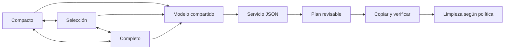

# nüün · ventana y flujo de ingreso

Estado/evidencia vigente: [STATUS](../STATUS.md). Operación: [operations](../operations.md#app-de-desarrollo-y-launcher). Esta página describe responsabilidades y límites, no duplica los release gates.

## Una ventana, tres presentaciones

`WindowRoot` mantiene el mismo `Model` y un solo `NSWindow`: compacto (440×700 pt), selección (780×820) y completo (1180×900, redimensionable/pantalla completa). El tamaño se limita al área visible. La esquina permite expandir/compactar; elegir archivos desde compacto abre selección directamente. Proyecto, fuente, selección por unidad y plan viven en el modelo, no en la vista. El cambio anima el frame y respeta Reduce Motion; reactivar desde el launcher conserva el modo visible. Las dimensiones son preferencias de presentación, no coordenadas de negocio.

## Carga y resúmenes

Al entrar en selección/completo, la fuente elegida se inspecciona automáticamente. Una clave fuente/tipo/archivo evita repetir el escaneo al cambiar de modo; una petición cancelada o antigua no reemplaza los datos actuales. IDs de generación impiden que una respuesta cancelada de la misma fuente cierre el loader de una petición nueva. El lector utiliza un cliente independiente: cancelar una inspección no cancela una transferencia. No hay sondeo periódico en reposo. Compacto evita esa carga hasta expandir o elegir archivos. Montaje/wake siguen sus gates de destinos registrados.

Las miniaturas visibles cargan con Quick Look y un loader por elemento, cuatro peticiones activas, caché de 24 MB/160 entradas y clave path/tamaño/mtime. El grid usa imágenes y metadatos sin tarjeta de fondo por archivo. Los contadores representan unidades/pares/bundles; no siempre equivalen al número de archivos físicos. Dron/360 sólo se muestran cuando se clasifican explícitamente; no se interpreta toda marca DJI como dron. El resumen previo muestra tipos, evidencia de cámara y raíz de respaldo; las rutas definitivas, con fecha/modelo/clasificación, pertenecen al plan. EXIF/registro persistente de cámaras sigue pendiente.

Stalker muestra fecha/duración/pistas cuando el manifiesto las ofrece; sesiones activas se omiten. En una biblioteca compartida sólo se visitan bundles `.stalker` de su primer nivel (o un bundle elegido directamente); archivos/editor projects ajenos no se recorren. Discovery y planner comparten el filtro de sesiones ya archivadas en el destino seleccionado. La carpeta de la biblioteca se configura explícitamente en Ajustes → Capturas. Un proyecto distinto por sesión/unidad se asigna en el grid; también hay sugerencias de proyectos existentes y texto para uno nuevo.

## Perfiles y ubicaciones

Los perfiles guardados tienen ID, etiqueta, carpeta relativa de raws y discos sugeridos. Elegirlos en la app aplica esas sugerencias; el usuario revisa siempre los destinos reales. La carpeta se aplica tanto a UI como CLI por el planner común. Un job tiene un destino de archivo y como máximo un SSD activo: varios SSD por perfiles dentro del mismo job no están implementados.

`profile_routes` congela las carpetas usadas en el digest/recibo del plan; cambiar un perfil no cambia copias anteriores ni un plan revisado. El registro de perfiles/etiquetas/sugerencias vive en el catálogo local y requiere la política de backup de metadata pendiente; los recibos conservan la ruta de cada job, no restauran toda la configuración.

## Bandeja y siguientes pasos

Bandeja reúne tarjetas sugeridas, Stalker terminado pendiente, trabajo diferido y operaciones bloqueadas. Cada fuente prepara su plan: no hay aún una transacción global que copie/limpie todas las filas. No se elimina una captura Stalker desde esta UI; faltan política de retención y coordinación con consumidores antes de ofrecer «respaldar y borrar».

Pendientes de aceptación: reconexión real/popup, bibliotecas y tarjetas enormes, pérdidas de eventos, benchmarks de CPU/memoria, fullscreen/Spaces en diferentes pantallas y matriz de accesibilidad/contraste. La instalación usa runtime Python externo y no implica release portable/notarizado.
