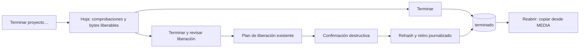
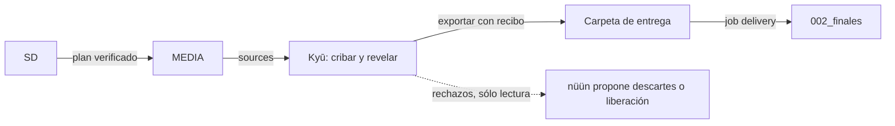

# Flujos de producto y cierre de trabajo · propuesta 2026-10-30

**Propuesta: nada de esta página está implementado salvo donde se indica.** Lo vigente está en [STATUS](../STATUS.md); las prioridades, en [PLAN](../../PLAN.md). La vista de discos tiene su propia especificación: [mapa de almacenamiento](storage-map.md).

Base: `master` en `b501864`, [landing](../../../../landings/nuun/app/LayerStory.tsx) en `aa0da14`, Kyū en `b14878f`. Se leyó código y documentación. Las cifras de discos y catálogo se tomaron el 2026-10-30 con `df`, `du` y SQLite `mode=ro`, sin escribir en los discos ni ejecutar flujos.

Actualización 2026-11-04: [primera entrega del cierre de proyectos](../contracts/project-closeout-v1.md). El diagnóstico original es histórico donde esa entrega lo sustituye: ya existen estados y cierre revisado de raws/renders/finales. No incluye borrar editables Clipper ni operar sobre Final Cut.

Actualización 2026-11-05: [Ingreso directo](../contracts/ingest-flow-v1.md) implementa Entrada → Flujo → Resultado, revisión agrupada, autorización única, progreso global y correcciones de proyecto/auxiliares/popup/centrado. [Cierre actualizado](../contracts/project-closeout-v1.md#actualización-vigente--2026-11-05): `subidos` o marca manual por final, sin gestión por canal. Respaldar publicados puede preceder al cierre completo; raws/renders se conservan hasta esa acción explícita.

## Diagnóstico histórico · 2026-10-30

Las tablas de diagnóstico/landing y los «Hoy» siguientes describen esa fecha, no el backlog actual. Ingreso, índice de discos, proyectos, publicación y cierre ya tienen entregas posteriores; consultar las actualizaciones de arriba y PLAN. La captura del README ya se actualizó el 5 noviembre. El estado actual de Atlas y A1–A10 vive en su [contrato](../contracts/atlas-drone-v1.md).

El motor de ingreso está bastante adelantado. Lo que falta para cerrar el ciclo que promete la landing son tres conceptos que hoy no existen:

1. **Un proyecto no tiene ciclo de vida.** La tabla `projects` sólo guarda `id`, `profile` y `title`. Hay estados de job, de copia de trabajo y de publicación, pero ninguno puede expresar «terminé esto». Por eso liberar espacio es una tarea manual por carpeta.
2. **El catálogo sólo conoce lo que pasó por nüün.** Conoce 19.1 GB de los 445 GB ocupados en ESSD, cerca del 4 %. `0000_acomodar` ocupa 141 GB y ningún flujo la toca. Sin un índice de todo el disco no se puede responder qué lo está llenando.
3. **El ingreso supone una fuente de una sola vez.** Sirve para una tarjeta, no para una carpeta viva como música o samples. Tampoco se puede conservar sólo una parte: toda unidad descubierta va al archivo, y la selección actual sólo decide la copia de trabajo.

## La landing contra lo implementado

| La landing dice | Estado real | Qué hacer |
| --- | --- | --- |
| Conecta la SD; muestra qué trae; no interrumpe sin discos | Implementado. Falta aceptar el popup de reconexión en físico | Aceptación física |
| Varios proyectos por tarjeta; nombre, destino y espacio antes de copiar | Implementado | — |
| «Fotos RAW y JPG viajan juntas» | nüün las agrupa como `camera_bundle`, pero [Kyū sólo importa `kind: file`](../../../../ai/kyu/core/crates/kyu-core/src/nuun.rs), así que los pares no llegan a Kyū | Corregir en Kyū ([fotos](#fotos-y-kyū)) |
| «Si se desconecta un disco, se pausa» | Cubierto con fixtures; faltan las pruebas físicas de desconexión en ExFAT | Aceptación física |
| «Tarjeta libre al terminar» | En Sony el job termina en `camera_action_required`: hay que formatear en la cámara | Decirlo en el copy |
| «Sin duplicados» | Sólo adopta un archivo idéntico en la misma ruta de destino; no hay deduplicación global | Fase 1 lo hace visible; ajustar el copy mientras tanto |
| «Tu editor siempre encuentra sus archivos» | Clipper reenlaza con ACK; Final Cut no participa | Cambiar «siempre» y nombrar Clipper |
| «Los videos finales vuelven a tu respaldo» y «Publicado» | `source_kind=delivery` y `set_publication` existen en el motor, sin UI ni flujo guiado | Fase 2 |
| «Termina el proyecto. Libera espacio» | Hay que escribir la carpeta y el proyecto a mano. Conserva `clipper/`, `renders/` y bibliotecas FCP, y la auditoría nunca se ha corrido en discos reales | Fases 1–3 |
| «Encuentra archivos aunque el disco esté guardado», con búsqueda por archivo, disco y estado | La tabla no tiene nombre de archivo, disco, tamaño ni estado en línea, y la búsqueda sólo mira proyecto, perfil, cámara y lugar | Fase 2 |
| «Hoy nüün brilla con video, fotos y audio» | Video y Stalker tienen uso real; fotos sólo vista previa de plan; H6 sólo fixtures; no hay flujo de audio | Suavizar hasta la fase 4 |
| «Agentes de IA · disponible» | Existe MCP stdio de sólo lectura; no hay guía ni cliente configurado | Documentar cómo conectarlo |
| «Pruébalo en tu Mac» | Requiere compilar desde código; runtime Python externo, sin notarizar | Aclarar el requisito |
| Integraciones | No menciona Kyū; el `alt` de la captura aún nombra «bandeja» | Añadir Kyū; regenerar captura al cambiar la navegación |

La landing no se modificó. Cambiar su copy es trabajo de su propio repo.

## Navegación

Cuatro pestañas desde el 2026-11-01, con Biblioteca como centro de lo que ya existe y Flujos como pestaña principal. Implementado, incluida una primera versión de Proyectos (2026-11-01) con etapa, estado declarado y renombrar; sin hoja de cierre ni liberación por proyecto:

```text
Inicio · Ingreso · Flujos · Biblioteca
                   ├─ Proyectos   qué tengo y en qué estado (fase 2, será la vista por defecto)
                   ├─ Archivos    la tabla actual (disco, tamaño y disponibilidad en fase 2)
                   ├─ Discos      mapa de almacenamiento (reemplaza Espacio)
                   └─ Actividad   la vista actual
```

| Hoy en Espacio o Actividad | Pasa a |
| --- | --- |
| Auditar una carpeta | **Comprobar** en Discos, con hashes guardados |
| Revisar y aplicar una liberación | Hoja «Revisar liberación», abierta desde Proyecto o Discos, sobre el mismo plan registrado |
| Planes guardados / reanudar | Actividad |
| Respaldar catálogo | Ajustes → Discos |
| Progreso de una operación | Indicador global en la toolbar; al mover Actividad a un subtab no debe perderse de vista |

Inicio sigue siendo la bandeja de lo que requiere atención y en la fase 2 gana una fila: «Parece terminado». En código, `Route` tiene cuatro casos y `LibrarySection` las secciones de Biblioteca, con el mismo `Model`. ⌘1 Inicio, ⌘2 Ingreso, ⌘3 Archivos, ⌘4 Actividad, ⌘5 Discos y ⌘6 Flujos: Actividad y Discos siguen donde estaban Actividad y Espacio.

## Proyecto: ciclo de vida y cierre

**Estado declarado por la persona**, nunca inferido: `activo` (por defecto), `pausado` o `terminado`.

**Comprobaciones calculadas**, siempre visibles en el detalle del proyecto:

| Comprobación | Fuente | ¿Bloquea liberar? | Hoy |
| --- | --- | --- | --- |
| Raw en archivo | Rehash actual al liberar; recibos para mostrar | Sí | Existe |
| Consumidores | Dependencias y ACK de Clipper | Sí | Existe |
| Final Cut y apps no integradas | Confirmación humana explícita | Sí, hasta confirmar | Falta |
| Finales en archivo | Jobs `delivery` | Avisa | Motor sí, UI no |
| Proyecto editable | Decisión: conservar en SSD, archivar o «no voy a reeditar» | Avisa | Falta |
| Publicación | Tabla `publications` | No | Motor sí, UI no |
| Réplica única | MEDIA quedaría como única copia | Avisa | Texto en confirmación |

**Marcar como terminado** es un solo paso y no borra nada. Liberar es una decisión aparte, en la misma hoja:



- **Sugerencia, nunca automatismo:** Inicio muestra «Parece terminado» cuando todas las variantes están publicadas, Clipper no tiene cola y el [índice](storage-map.md) no ve cambios en 30 días (configurable). Sólo ofrece abrir la hoja.
- **Reabrir** vuelve a `activo` y ofrece `deliver_work` desde MEDIA.
- **Material antiguo:** desde Discos, «Adoptar carpeta» asocia una carpeta existente a un proyecto sin moverla ni renombrarla.

Datos, en tablas aditivas del catálogo, incluidas en las instantáneas porque son decisiones humanas: `project_lifecycle(project_id, state, editable_decision, note, updated_at, closed_at)` y `project_folders(volume_id, path, project_id)`.

### Qué significa «eliminar trabajo completado»

**Decisión vigente, 2026-11-04:** se conservan fuentes originales y finales. Los intermedios identificados pueden descartarse sin respaldo, con revisión y consentimiento explícitos; esta primera entrega se limita a `renders/` de carpetas conocidas del proyecto. Los raws reutilizan recibos/verificación existentes. Editables Clipper se conservan hasta disponer de retiro con desregistro; Final Cut y lo desconocido se conservan. Esto sustituye las alternativas anteriores de archivar todos los intermedios/editables.

| Nivel | Qué retira | Requisito | Estado |
| --- | --- | --- | --- |
| 1. Copias de trabajo | Raws en SSD ya verificados en MEDIA | Plan de liberación | Existe |
| 2. Regenerables | Intermedios declarados descartables | Plan y consentimiento explícitos, sin copia | Primera entrega: `renders/` de proyectos conocidos; otros cachés pendientes |
| 3. Editable | Proyecto Clipper | Se conserva; retiro desde Clipper hasta API con desregistro | Pendiente; Final Cut fuera de alcance |
| 4. Descartes | Material que nunca se quiso guardar | [Conservar sólo lo que sirve](#conservar-sólo-lo-que-sirve) | Fase 4 |
| 5. Borrar del archivo | Última copia en MEDIA | No se ofrece en esta propuesta | Fuera de alcance |

## Conservar sólo lo que sirve

Para drones, fotos y tomas de prueba. Hoy toda unidad descubierta se archiva. Propuesta:

- **Conservar todo** sigue siendo el valor por defecto.
- **Conservar selección** archiva sólo lo marcado. Lo demás permanece en la tarjeta y la limpieza no lo toca.
- **Descartar el resto** es una acción aparte, con su propia confirmación y lista incluida en el digest del plan. Sólo se habilita cuando lo elegido ya está verificado en sus destinos.
- **Registro del descarte:** nombre, tamaño, fecha y decisión, sin bytes, para que nüün no vuelva a sugerirlo y quede constancia.

## Flujos por tipo

| Flujo | Fuente | Copias | Después | Limpieza | Hoy |
| --- | --- | --- | --- | --- | --- |
| Video de cámara | SD | MEDIA + ESSD | Clipper / Final Cut | Tras verificar; Sony termina con formato en cámara | Uso real |
| Pantalla | Stalker | MEDIA + ESSD opcional | Clipper | Original local liberado tras ACK | Uso real pequeño |
| Fotos | SD | MEDIA; trabajo opcional | Kyū | Tras verificar | Sólo vista previa |
| Audio grabado | SD (H6) | MEDIA + SSD1 | Editor / SoundShop | Tras verificar | Fixtures |
| Dron | SD | MEDIA, con categoría explícita y selección | Atlas, por handoff | Tras verificar | Fixtures; Atlas sin iniciar |
| 360 / acción | SD | MEDIA + trabajo | Clipper | Tras verificar | Fixtures |
| Entregas | Carpeta de finales | `002_finales` | `subidos` o marca manual Publicado, sin canales | Movimiento/liberación explícitos | UI de publicados y cierre; aceptación física pendiente |
| Música y samples | Carpeta viva | MEDIA, incremental | curado / SoundShop | Nunca | Falta |
| Descargas y stems | Proveedor / derivado | Staging, luego colección | Registrar procedencia | Nunca | CLI aislada |
| Material viejo | Carpeta del SSD | MEDIA sin renombrar | Adoptar a proyecto | Liberación explícita | Parcial |

Mezclas en una tarjeta: se resuelven por unidad, como hoy. Nunca se clasifica por marca o carpeta residual; DJI sigue pidiendo categoría.

### Fotos y Kyū

Cada app conserva lo suyo: nüün ingresa y limpia; Kyū criba, revela y exporta, y nunca borra originales.



Orden recomendado: **primero respaldar, después cribar**. Es el más seguro para material de clientes y el que Kyū ya soporta. También puede cribarse antes, porque Kyū lee tarjetas en sólo lectura: sus elegidas alimentarían «Conservar selección».

Falta, por dueño:

| Dueño | Cambio |
| --- | --- |
| Kyū | Aceptar `camera_bundle` en [`photo_sources`](../../../../ai/kyu/core/crates/kyu-core/src/nuun.rs) para que lleguen los pares RAW+JPG |
| Kyū | Resolver el comando: `nu9ve` es un alias de shell y no existe en `PATH` para una app abierta desde Finder. Hasta tener un ejecutable instalado hay que fijar `KYU_NUUN_COMMAND` |
| Kyū | Exponer un deep link para abrir un proyecto y una lectura de decisiones por `nuun_asset_id` |
| nüün | Botón «Abrir en Kyū» al terminar el ingreso, sólo si Kyū está disponible, y comando estable instalado |
| nüün | «Importar entrega» desde UI y, a futuro, deep link «ingresar esta tarjeta» (pedido por Kyū) |

Los rechazos de Kyū nunca borran por sí solos: nüün los lee y arma un plan revisable. La aceptación con RAW reales sigue pendiente en ambos repos.

### Finales y `subidos`

`002_finales` en el SSD es material en uso: el usuario lo mantiene ahí hasta publicar y entonces lo mueve a su carpeta de publicados (`e64/03_subidos`, `9logs/subidos`). Sólo eso toca respaldar y después liberar. Inicio y Flujos separan por perfil lo que está por respaldar, lo que espera publicarse y lo que ya está en respaldo. La carpeta se detecta por nombre (`subidos` o `publicados`, con o sin número) y se puede elegir por perfil. Sin carpeta, todo lo que no esté en el respaldo cuenta como por respaldar, pero no se ofrece copiar. La carpeta es la declaración de publicación de la persona; no es evidencia externa ni prueba de respaldo íntegro. También puede marcarse Publicado desde el proyecto sin mover primero a `subidos`.

**Ruta implementada (2026-11-01):** **Mover al respaldo…** arma un plan normal con SHA-256 y, en la misma ejecución, libera el disco de edición con la limpieza verificada de las tarjetas: vuelve a leer cada original, comprueba la copia y lo borra, con registro por archivo. Por defecto mueve, porque respaldar lo publicado es para recuperar espacio; **Conservar en el disco de edición**, en la revisión, lo evita. Mover exige discos físicos distintos y se bloquea si Clipper reporta que usa esos archivos. **Desde el 2026-11-04**, Clipper desconocido o con proyectos offline también conserva el origen; ya no se acepta la excepción anterior.

| En el SSD | En el respaldo |
| --- | --- |
| `e64/03_subidos/26-10-27-terra-6-1.mov` | `e64/2026/`, con el año del nombre o, si no lo trae, de la fecha de creación, porque un re-export cambia las fechas |
| `e64/03_subidos/shorts/…` | `e64/shorts/…` |
| `e64/03_subidos/thumbnails/…`, con sus `.txt` | `e64/thumbnails/…` |

- Un idéntico en el destino se adopta tras verificarlo. Uno de tamaño distinto bloquea el plan y dos finales al mismo destino también.
- Lo que el respaldo del perfil ya tiene en otra carpeta con igual nombre y tamaño no se duplica ni se borra, porque esta operación no lo verificó: el plan lo lista en `already_archived` y se queda en la carpeta.
- Sólo sale lo planeado. Un final que llegue durante la copia se queda y se avisa; las carpetas no se borran.
- El proyecto del catálogo es `finales`, por perfil. No adivina a qué proyecto pertenece cada final y no aparece entre los proyectos rápidos.

**Falta:** «Ya en respaldo» fuera de `subidos` compara nombre y tamaño; liberarlo exige el rehash del plan de liberación, no esta lectura.

**Primera entrega, 2026-11-04:** Proyectos → **Completar y liberar…** vincula finales por selección confirmada, incluidos los ya archivados. Requisitos por perfil/proyecto y declaraciones «ya publiqué» / «ya no habrá más»: `9logs` inicia con horizontal; `e64`, con horizontal, al menos un vertical y thumbnail. Puede copiar los finales elegidos y liberar raws verificados y renders en una operación revisada. Inicio recuerda **Falta liberar trabajo** tras guardar un cierre completo pendiente. Terminar por sí solo no borra. [Contrato, límites y reanudación](../contracts/project-closeout-v1.md).

### Carpetas vivas: música y samples

Las fotos y el video de cámara **no** son carpetas vivas: siguen el respaldo general por tipo que ya aplica [layout.py](../../media/layout.py) (`images/`, `rimages/`, `360/images/`, por año y mes). Las selecciones terminadas de fotos son entregas y van a finales, organizadas por fecha y nombre de proyecto.

Una carpeta viva es otra cosa: música, samples o bibliotecas que cambian y se respaldan muchas veces. Es un `source_kind` nuevo, distinto de una tarjeta:

- Conserva árbol y nombres; no aplica el nombrado de cámara.
- Es incremental: usa el [índice](storage-map.md) para copiar sólo lo nuevo o cambiado, con la misma verificación SHA-256.
- Nunca limpia el origen ni propaga borrados: si algo desaparece del origen, se informa.
- «Completar» significa ver qué falta por respaldar y copiar sólo eso.
- curado y SoundShop siguen leyendo sus carpetas; nada cambia para ellas.

También sirve para respaldar bibliotecas FCP o proyectos Clipper, que el planner de hoy rechaza. Una biblioteca se trata como unidad y no se copia mientras su app la tenga abierta.

### Por acomodar

`0000_acomodar` es un cajón de cosas que aún no tienen lugar. No se reorganiza ni se respalda por defecto. Se revisa desde [Discos](storage-map.md#por-acomodar), carpeta por carpeta, con tres salidas:

| Resultado | Qué significa | Acción |
| --- | --- | --- |
| Ya lo tengo | Hay copia idéntica en el respaldo, aunque tenga otro nombre | Revisar liberación |
| Sirve | Sólo existe aquí y vale la pena | Asignar proyecto y respaldar |
| Ya fue | No sirve | Descartar, con confirmación y sin pasar por el respaldo |

La fase 1 ya responde «ya lo tengo»; las otras dos salidas llegan en las fases 3 y 4.

### Drones y Atlas

Selección por vuelo con «Conservar selección»; pares JPG+DNG juntos. Atlas es dueño de GPS, vuelos y derivados: nüün entrega por handoff y nunca dispara procesamiento por montar un disco. Los derivados de Atlas sólo cuentan como regenerables si Atlas o la persona lo declaran.

## Flujos

Pestaña principal por decisión del usuario (2026-11-01), en lugar de una sección de Ajustes: va a crecer y necesita espacio para entenderse. **Implementado:** vista de sólo lectura con los flujos actuales dibujados como bloques y líneas, con los discos reales y un estado honesto por bloque (automático, lo confirmas en el plan, lo haces tú, aún no disponible). **Sin implementar:** recetas editables, los niveles de abajo sobre datos guardados y registro de cámaras.

Tres niveles sobre un mismo dato. Cada uno es opcional y no se necesita el siguiente para usar el anterior.

**1. Por defecto, cero configuración.** Un flujo sugerido por tipo, editable. El Ingreso sigue siendo fuente + proyecto + revisar.

**2. Lista de flujos con una frase.** Cada flujo se activa o desactiva y se lee como una oración cuyos términos son menús:

> Las **fotos** de **tarjetas** se copian a **MEDIA**, **sin copia de trabajo**; al verificar, **limpiar la tarjeta** y **abrir Kyū**.

**3. Vista de bloques**, inspirada en Audio Hijack, pero en línea con ramas y no un lienzo libre:

```text
[Tarjeta] → [Sólo fotos] → [Elegir] ─┬→ [Copiar + verificar: MEDIA] ─┬→ [Limpiar tarjeta] → [Abrir Kyū]
                                     └→ [Copiar + verificar: ESSD]  ─┘
```

| Tipo de bloque | Ejemplos |
| --- | --- |
| Fuente | Tarjeta, Stalker, carpeta, colección |
| Filtro | Por tipo, cámara, fecha, selección manual |
| Copia | Archivo, trabajo (verificar va incluido, no es un bloque) |
| Acción local | Registrar entrega, ofrecer expulsar, abrir app |
| Salida | Limpiar origen, liberar copias |

Se recomienda bloques y no un grafo libre porque casi todos estos flujos son lineales con una bifurcación. Se dibujan con SwiftUI, sin dependencias. El lienzo libre sólo se justifica si aparecen flujos reales que no quepan.

**Reglas que no se pueden configurar:**

- Una receta **no ejecuta nada**: produce parámetros para `build_plan`. Plan, digest, revisión y `apply` no cambian, y CLI y app siguen compartiendo el motor.
- Copiar siempre verifica, y la salida sólo puede ir después de verificar todas las copias requeridas. Una receta que lo contradiga no se guarda.
- Los valores resueltos se congelan en el plan, como `profile_routes`. Editar una receta no cambia planes revisados ni copias anteriores.
- Sin destino registrado en línea no hay popup ni lectura profunda.

**Automatización, por receta:** `manual` (por defecto), `preparar` (deja el plan listo al conectar, sin lectura profunda si no hay destinos) y, después de la aceptación física, `copiar` (ejecuta sólo copias). Limpiar y liberar siempre requieren confirmación.

**Perfil y flujo son independientes.** El perfil (e64, 9logs) es el contexto creativo y decide carpetas. El flujo decide qué hacer según el tipo de archivo. Las recetas viven en el catálogo, como los perfiles.

## Fases

Cada fase se puede usar por sí sola. Las primeras no pueden perder datos, por lo que pueden avanzar en paralelo a la aceptación física.

| Fase | Entrega | Riesgo | Se acepta cuando |
| --- | --- | --- | --- |
| 0 · Operativa | Ciclo físico pequeño; `coverage --no-hash` de ESSD contra MEDIA; copy de la landing | Bajo | Hay evidencia real en STATUS |
| 1 · Ver | Implementada: navegación, índice y Discos en sólo lectura | Ninguno sobre media | Explica el uso de ESSD sin leer contenido ni recalcular. Falta tu aceptación en la app y analizar MEDIA502 |
| 2 · Cerrar | Proyectos, ciclo de vida, Archivos con disco y tamaño, entregas y publicación en UI, cierre sobre liberación existente | Medio | Un proyecto real pasa de activo a terminado y liberado, y se reabre |
| 3 · Colecciones | `source_kind` colección, «Sólo aquí → respaldar», editables, regenerables, adoptar carpetas | Medio | `0000_acomodar` y la música tienen cobertura incremental |
| 4 · Tipos | Fotos con Kyū, audio, dron, conservar selección y descartes | Alto en descartes | RAW reales, H6 y DJI aceptados en físico |
| 5 · Flujos | Recetas con frase y automatización `preparar` | Bajo | Una receta genera el mismo plan que la UI manual |
| 6 · Extensión | Vista de bloques; descargas y stems en catálogo | Bajo | Según uso real |

La [revisión de app](app-review-2026-10.md) sigue vigente para DiskArbitration, progreso empujado y agrupación de la grilla; se atienden cuando toquen esas zonas.

## Decisiones tomadas en esta propuesta

Reversibles; se documentan para no volver a discutirlas sin un motivo nuevo.

- Espacio desaparece como pestaña; Actividad pasa a subtab.
- Terminar un proyecto nunca borra.
- Respaldar antes de cribar es el orden por defecto en fotos.
- Bloques en línea antes que lienzo libre.
- Colecciones sin propagar borrados.
- Hasta la fase 3, la decisión por defecto del editable es «conservar en SSD».

## Decisiones del usuario · 2026-10-30

- **Copias:** una en el respaldo y otra opcional en trabajo, que después se puede borrar. La redundancia no es prioridad; más adelante será configurable para quien tenga varios discos. La UI avisa de la réplica única sin insistir.
- **Nube:** posible producto de paga para redundancia y otras funciones, a futuro ([política](replication-policy.md#opciones-futuras-no-decididas)). No forma parte de este plan.
- **Fotos:** se quedan en el respaldo general por tipo. Las selecciones terminadas van a finales, por fecha y proyecto.
- **`0000_acomodar`:** nada hasta verla en el mapa; después, [revisarla por partes](#por-acomodar).

## Decisiones del usuario · 2026-11-01

- **Flujos es una pestaña principal**, con bloques y líneas.
- **Finales:** sólo se respalda y libera lo que está en la carpeta de publicados, en una sola acción y moviendo por defecto. El año de un master sale del nombre y, si no lo trae, de la fecha de creación.
- **Perfil:** `e64` sigue como ID y carpeta y `erikiado64` es su nombre visible; no se renombran carpetas. `000_acomodar/erikiado64` se revisa aparte.

## Pendiente de decidir


Destino en MEDIA para música y samples. Se decide al implementar la fase 3, con la carpeta real a la vista.
