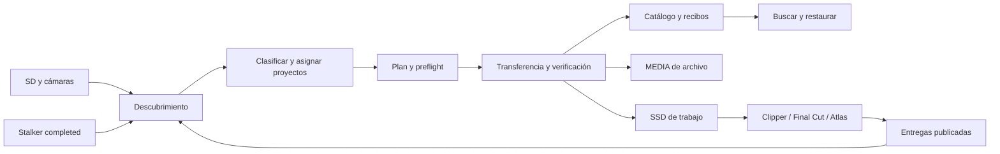

# Arquitectura propuesta de media

Documento de diseño. El motor `media/`, catálogo y app nativa ya tienen implementación; consulta [STATUS](STATUS.md) para límites/evidencia y [development](development.md) para ownership actual. Las secciones objetivo no implican que todo esté terminado. [PLAN](../PLAN.md).

## Responsabilidades

`n-creator-utils` administra descubrimiento, clasificación, ubicación, verificación, archivo y recuperación. Stalker graba; Clipper edita/sincroniza/renderiza; Final Cut conserva su biblioteca y ediciones; Atlas procesa imágenes y geografía. El catálogo enlaza identidades, no reemplaza esas autoridades ni modifica sus formatos por cuenta propia.



## Separación de módulos objetivo

| Capa | Propuesta | Contrato y límite |
| --- | --- | --- |
| Dominio | `media/models`, `policies`, `planner` | Objetos inmutables, settings por operación, sin globals ni imports UI. Proyecto/perfil distintos de dispositivo. |
| Descubrimiento | `media/discovery`, adaptadores Sony/Canon/DJI/H6/Stalker/entregas | Evidencia y relaciones, nunca movimiento. Metadatos costosos bajo demanda y cacheados. El inventario actual migrará aquí cuando exista el planner. |
| Transferencia | `media/transfer`, `journal`, `verification` | Única autoridad de escritura de media gestionada; staging, hashes, locks, recibos, recuperación. |
| Persistencia | `media/catalog`, `repositories` | SQLite local por equipo; manifiestos portables y recibos en cada archivo. Separar datos humanos de índices reconstruibles. |
| Plataforma | `platforms/macos`, futuras `windows` / `linux` | Discos, eventos, bookmarks/permisos, notificaciones, safe eject. Capabilities explícitas. |
| Entradas | CLI y `apps/MediaMenu` Swift | Mismo planner; UI no implementa su propio copy/delete. Procesos JSON al principio; worker sólo durante jobs. |
| Otros brazos | `downloads`, `audio/stems`, `hardware` | Adaptadores separados que producen assets/provenance para el catálogo. No otro editor dentro de este repo. |

No mover todo a nuevos paquetes en un cambio cosmético. Extraer una responsabilidad al introducir su prueba y sustituir su llamada. Mantener el importador antiguo aislado hasta tener paridad verificada. `hardware` y scripts manuales se conservan hasta inventariar usos; MIDI no forma parte del daemon de media.

## Modelo de datos

| Entidad | Identidad y campos importantes |
| --- | --- |
| Perfil | UUID/clave estable, nombre visible `erikiado64`, aliases `e64`; referencia opaca al perfil creativo de Clipper. Reglas de trabajo y finales. |
| Proyecto | UUID estable, título/slug mutable, país/ciudad independientes, perfil principal y asociaciones adicionales. |
| Dispositivo | ID local, fabricante/modelo/serie si hay evidencia; confianza/procedencia, alias del usuario. La SD no es la cámara. |
| Volumen | ID registrado + UUID del filesystem + identidad física disponible, rol, capacidad, último montaje. El formateo invalida el registro anterior; clones requieren distinguirse. |
| Asset | UUID, tipo/rol, fecha de captura con zona y precisión, fechas originales, dispositivo, proyecto(s), tags. Un cambio de título no cambia bytes/ID. |
| Revisión de contenido | ID, lista de miembros y SHA-256, tamaño, padre y razón de cambio. Separa identidad lógica de una versión exacta. |
| Bundle/captura | Unidad indivisible de conservación, miembros relativos, autoridad de manifest externo. Stalker usa su `sessionID`; JPG+DNG y sidecars quedan asociados. |
| Ubicación | Asset/revisión + volumen + ruta relativa, función `source/work/archive`, verificación/fecha, disponibilidad. Tener dos ubicaciones no demuestra dos discos físicos. |
| Asignación editorial | Proyecto ↔ asset, rol, orden explícito de selección, tipo tutorial/multicam/set/Atlas, estado pendiente/confirmado. Un clip que sirve a dos proyectos conserva un original. |
| Job / recibo | Plan inmutable, hash del plan, política/versiones, progreso por miembro/destino, errores, verificación, intentos. |
| Dependencia / lease | Consumidor, proyecto/revisión/cola, assets fijados, propósito, liberación o ACK de relink. Lease vencido obliga revisión; nunca autoriza borrado por sí solo. |
| Entrega / publicación | ID de entrega y variantes master/short/thumbnail/texto/subtítulos, vínculo al proyecto, fechas, canal/URL si existe y confirmación manual. |

Registrar fecha local y UTC cuando se conocen, offset y precisión (`metadata`, `manual`, `mtime_fallback`). Una hora sin zona sigue siendo ambigua: no convertirla inventando zona. No sincronizar cámaras sólo por fecha; sirve para sugerir agrupaciones, el editor resuelve sync por audio/reloj.

Estado de publicación, disponibilidad de trabajo y protección de datos son ejes independientes. «Publicado» no significa «se puede borrar el raw»; «archivado» no significa «dos copias permanentes»; «offline» no significa «perdido».

## Layout y adopción sin migración masiva

Se mantienen `MEDIA502/001_raw`, `002_finales` y los proyectos existentes de ESSD. Primero indexar en modo observación; registrar nombres originales y finales por archivo. No intentar extraer proyecto automáticamente de los históricos donde hoy se usó `city`: ofrecer revisión por lote.

Para nuevas unidades, layout configurable sugerido:

```text
<archivo>/001_raw/stalker/YYYY/MM/<fecha>_<slug>_<id-corto>.stalker/
<archivo>/001_raw/camera-bundles/YYYY/MM/<ingest-id>/<estructura-original>/
<archivo>/002_finales/<perfil>/<fecha>_<slug>/<entrega-id>/
<trabajo>/001_proyectos/<perfil>_raw/<slug>/{camera,stalker,audio}/
<trabajo>/001_proyectos/<perfil>/<slug>/       # exports elegidos para Final Cut
<trabajo>/002_finales/<perfil>/               # nombres finales actuales permitidos
<raiz-gestionada>/.ncreator/{manifests,receipts,staging}/
```

Las raíces de archivo pueden variar por volumen registrado; no construir siempre `/001_raw` si la configuración histórica apunta ya dentro. Resolver `001`/`002` por roles, no por reemplazo de strings. Bundles Sony conservan árbol original como autoridad; vistas con nombres legibles pueden materializarse para trabajo junto con un mapa de procedencia. No duplicar automáticamente ambos layouts de todo un archivo existente.

Datos del programa en macOS: configuración y SQLite en `~/Library/Application Support/n-creator-utils/`; caché regenerable con cuota en `~/Library/Caches/n-creator-utils/`; logs con rotación. Propuesta Windows: LocalAppData; Linux: XDG config/data/cache. No guardar las únicas etiquetas humanas en una caché.

Nueva raíz Stalker sugerida: `~/Movies/Stalker/` o una carpeta externa elegida. Cada `.stalker` sigue completo; proyecto/fecha se agregan por carpeta padre o metadata acordada con Stalker. **No usar `.stalker` global como caché desechable**: sus originales no son regenerables. Configurar nuevas capturas no mueve las anteriores. Si el interno está lleno y el externo elegido no está, bloquear y ofrecer otra raíz; sin fallback silencioso.

## Política de discos y velocidad

| Política | Destinos requeridos | Cuándo ofrecerla |
| --- | --- | --- |
| H6/audio | Archivo MEDIA + trabajo SSD1, en dispositivos físicos diferentes | Flujo directo habitual. Si falta SSD1 pero está MEDIA, ofrecer excepción «Sólo respaldar» con confirmación por operación y trabajo pendiente u omitido registrado. |
| Cámara/video para editar | Archivo MEDIA + trabajo ESSD/XSSD seleccionado | Por perfil/proyecto. Seleccionar sólo los proyectos que vas a editar permite ahorrar SSD. |
| Sólo archivo | MEDIA | Si falta ESSD/SSD1, requiere confirmación adicional; registrar trabajo pendiente u omitido. Se distingue de trabajo listo y de redundancia adicional. |
| Stalker sin MEDIA | Captura local durable; estado pendiente de archivo | Se puede editar localmente manteniendo la dependencia registrada. No liberar su única copia. |
| Fotos Atlas | Archivo con JPG+DNG+exports de vuelo; working set de procesamiento elegido | Mantener nombres usados por Atlas y proteger estado humano, configuración y productos caros de regenerar. |

Para evitar SD→HDD→copiar manualmente: planear **SD→SSD trabajo→HDD archivo** cuando el SSD tiene espacio y forma parte del plan. Primero verificar SSD; después copiar desde esa revisión verificada al HDD y verificarlo independientemente. La SD queda intacta hasta verificar todos los destinos requeridos; después se limpia dentro del mismo flujo. Si ESSD se desconecta, job pausado y sin limpieza; revalidar UUID/montaje y miembro parcial al volver. Alternativa SD→HDD→SSD si el SSD no es estable, y sólo archivo cuando se elige esa política. No se ha medido qué topología es más rápida; lector, bus USB y HDD pueden dominar el tiempo.

No escribir media temporal en el interno por defecto. Staging vive en el mismo destino, cuenta en presupuesto y se retiene por job; el journal local ocupa sólo metadata. Fanout simultáneo y copia por chunks son optimizaciones posteriores a medir; generan más competencia de IO y complican recuperación.

Separar requeridos/opcionales. Un destino opcional faltante muestra estado parcial; jamás se presenta como «todo respaldado». MEDIA501/502 no se suponen espejos: cada réplica debe verificar cobertura real. Futuro HDD de dron puede ser otra asignación de colección; el catálogo localiza capturas sin depender de su etiqueta.

### Excepción confirmada: archivo sin disco de trabajo

MEDIA presente y ESSD/SSD1 ausente no es un bloqueo definitivo: detener el camino directo y pedir confirmación explícita de «Sólo respaldar en MEDIA». Mostrar qué copia falta y ofrecer «Dejar copia de trabajo pendiente» como elección inicial o «Omitir copia de trabajo». La excepción pertenece a ese job/selección; no elimina el requisito habitual del perfil para futuras tarjetas ni se acepta por timeout.

Persistir política habitual y efectiva, destino de trabajo esperado, motivo de excepción, confirmación y fecha, assets/revisiones incluidos y `work_delivery_status=pending|ready|skipped`. `pending` significa intención de copiar después; `skipped` es decisión explícita, no error ni copia realizada. El archivo verificado puede cerrar correctamente su política efectiva y permitir la limpieza de SD aunque trabajo siga pendiente/omitido. Nunca inventar un recibo de SSD ni presentar «listo para editar en ESSD» si sólo existe MEDIA.

Cuando vuelva el SSD registrado, agrupar pendientes por perfil/proyecto y ofrecer copiar desde archivo verificado o marcarlos omitidos. Preflight de espacio/identidad, verificación e idempotencia se aplican también a esa entrega diferida. No hace falta conservar/reinsertar la SD ya liberada. Si MEDIA está offline, mostrar el pendiente y esperar su conexión; no iniciar automáticamente una copia grande sólo por montar ESSD. Un omitido puede retomarse manualmente manteniendo historial.

### Cuándo mostrar el panel de SD

Comprobar primero si hay algún destino de media registrado y montado: MEDIA de archivo, ESSD/XSSD o SSD1 de trabajo. Sin ninguno, no mostrar popup ni notificación de ingreso, no escanear profundamente la SD ni iniciar jobs: se asume una tarjeta abierta para consultar otro contenido. La entrada manual de inspección/importación sigue disponible.

Con al menos un destino registrado se puede sugerir ingreso, pero cada plan valida los destinos que necesita. Tener sólo SSD de trabajo no equivale a tener archivo MEDIA y no activa la excepción anterior, que sólo omite trabajo; tampoco autoriza por sí solo limpiar SD. Al conectar después un destino con la SD aún presente, reevaluar una vez y agrupar eventos, sin iniciar operaciones automáticamente. No confundir una carpeta residual o cualquier USB con destino registrado.

## Transacción de transferencia propuesta

1. Descubrir sin escritura; revisar asignaciones y congelar política/plan/destinos. Calcular bytes **asignados por filesystem**, margen configurable y staging pendiente, no sólo suma lógica. MEDIA502 usa bloques de 262144 bytes: muchos archivos pequeños pueden ocupar más de lo que suman sus tamaños.
2. Preflight: montajes, identidad, permisos, capacidad/reservas, solapamientos, filesystem y colisiones incluyendo case folding/Unicode, todas las dependencias obligatorias y estado de productores. Reservar destinos/lock de unidad entre CLI y app.
3. Registrar job local durable antes de crear staging en destinos. Revalidar mount e identidad antes de cada fase de escritura; dejar de escribir al desaparecer el volumen. No recrear la ruta de un disco ausente en `/Volumes`.
4. Leer origen estable, copiar en bloques acotados y hashear la lectura. Para SD, impedir que otro importador la procese. Para Stalker exigir `completed`, manifest y membresía estables; tamaño/mtime antes/después son sólo alarmas, no un lock del productor.
5. Flush de archivo y directorio donde sea soportado; leer de nuevo el archivo destino y comparar SHA-256. Verificar lista completa de miembros y hashes del paquete. Revalidar origen/manifest tras copia. Si cambió, invalidar candidato, conservar fuente y diagnosticar.
6. Publicar unidad verificada sin sobrescribir. Rename dentro del volumen facilita visibilidad, pero no prometer una transacción portable ni resistencia absoluta a apagones, especialmente ExFAT. El recibo/journal decide si una unidad está completa; una carpeta visible sin recibo no basta.
7. Guardar recibo en destino y catálogo con escritura atómica de metadata donde sea posible; journal permite reconciliar si sólo una de las dos escrituras llegó. Reiniciar debe reconocer el resultado y evitar duplicados por job/asset/revisión/destino.
8. Notificar disponibilidad a consumidores y ejecutar la fase de limpieza de SD incluida en el plan de ingreso. Sólo comienza tras verificar todos los destinos requeridos y persistir sus recibos; revalidar la tarjeta y el conjunto exacto a retirar. Mantener el borrado como fase separada en código/journal permite reanudar y auditar, sin imponer otra confirmación rutinaria al usuario. Los perfiles de cámara deben preservar su consistencia; ver política de cierre abajo. La limpieza de copias de trabajo, bibliotecas y cachés tiene otras dependencias y no se autoriza por este ingreso de SD.

Un corte de energía puede dejar bytes durables distintos del último recibo aparente: al reanudar, verificar antes de reutilizar. No se garantiza rollback de TB ya copiados; se conserva origen hasta el punto de verificación y se distinguen intentos parciales, limpieza parcial y cierre completo. Primera versión reanuda por archivo; rangos/chunks después.

## Cierre del ingreso y limpieza de SD

El resultado normal pedido por el propietario es **SD respaldada y libre para el siguiente proyecto**. `save` es destructivo por diseño; la mejora es hacer el borrado posterior a la verificación, completo y recuperable. Copy-only sirve como opción explícita o diagnóstico. No considerar la SD una réplica permanente obligatoria después del cierre.

Estados independientes y visibles: `copying` → `verifying` → `backup_verified` → `cleaning_source` → `source_ready`. Si la cámara necesita una acción propia, mostrar `camera_action_required`; no confundirlo con `source_ready`. Un destino opcional pendiente no bloquea limpieza salvo que la política lo requiera, pero su pendiente sigue visible. Audio normalmente exige MEDIA+SSD1; la excepción confirmada de sólo archivo cambia los requeridos de ese plan y deja trabajo pendiente/omitido registrado. Video sigue el mismo criterio con su SSD elegido.

Para perfiles probados, el plan inicial incluye limpieza automática tras éxito; no pedir confirmación por cada archivo ni una segunda aprobación al terminar. Antes de borrar, comprobar identidad de tarjeta, recibos de todos los miembros y ausencia de cambios nuevos. Retirar sólo miembros respaldados de esa revisión. Archivos desconocidos o excluidos deben preservarse en el archivo o resolverse en el plan antes de prometer «tarjeta limpia»; auxiliares no se descartan por extensión sin cobertura. En una importación parcial, indicar material restante en lugar de declarar la SD lista.

Registrar por miembro los retiros y fallos para que una interrupción de limpieza continúe sin duplicar copias o borrar material nuevo. Tarjeta que vuelve formateada o con nuevos archivos requiere reconciliación aunque conserve nombre/identidad física. Entregar a editores ubicaciones de destino, evitando crear dependencias nuevas sobre la SD que luego se limpia.

«Limpia» significa sin grabaciones de los proyectos anteriores y lista para grabar; puede conservar directorios e índices válidos creados por la cámara. No necesita cero archivos. Para Sony y otros formatos con base propia, validar en hardware qué se puede retirar y cómo queda consistente. Hasta tener ese perfil, terminar respaldo verificado y guiar la liberación/formateo desde la cámara, con estado pendiente explícito. Automatizar formateo no es equivalente a borrar los archivos respaldados: exige cobertura de toda la tarjeta y un flujo específico, fuera del borrado genérico.

Eficiencia: calcular el hash de origen durante la lectura que copia, leer cada destino para verificar y reutilizar esos recibos durante la limpieza del mismo job mientras sigan vigentes. No rehacer todas las copias, escanear el archivo completo ni hashear otra vez cada destino justo antes de cada borrado. Revalidar sólo evidencia invalidada por desconexión, cambios o recuperación tras fallo; la consistencia del origen requiere control de acceso y revisión del conjunto, no asumir que una ruta siempre conserva el mismo contenido.

## Catálogo, restauración y espacio

SQLite vive en el equipo para navegar discos offline, con un solo writer y migraciones versionadas. No mantener una SQLite WAL activa compartida entre varios discos/equipos. Los manifiestos y recibos en los volúmenes permiten reconstruir ubicaciones; exportar asignaciones humanas y respaldar el catálogo también. Un índice reconstruible y las decisiones humanas no deben confundirse.

Consultar por proyecto, perfil, fechas, cámara, tipo, publicación y disponibilidad. Restaurar genera el mismo plan verificado hacia Downloads, assets o ESSD, respeta bundles y orden, y registra otra ubicación; no cambia la identidad. Proyectos portables requieren incluir sus dependencias, no sólo `clipper-project.json`.

Mostrar bytes lógicos y asignados, originales/trabajo/archivo/derivados/cachés, reserva del siguiente job y último snapshot offline. No escanear todos los discos cada segundo. El tamaño lógico repetido no autoriza deduplicación destructiva; SHA igual identifica contenido repetido, pero las referencias deben sobrevivir.

Cuotas de caché por herramienta, LRU sólo para derivados declarados regenerables y sin uso activo. Eliminar un SSD de trabajo requiere recibos de archivo verificables y dependencia resuelta; Final Cut también puede tener bibliotecas referenciando raws. Hasta disponer de integraciones de leases, la ausencia de un registro no demuestra que el archivo no esté en uso.

## macOS primero y transporte futuro

Menubar SwiftUI/AppKit con `NSStatusItem` y ventana grande abierta bajo demanda. Observar montajes mediante [NSWorkspace](https://developer.apple.com/documentation/appkit/nsworkspace/didmountnotification) y enriquecer identidad/eventos con [Disk Arbitration](https://developer.apple.com/documentation/diskarbitration/diskarbitration-h). Para raíces gestionadas, [FSEvents](https://developer.apple.com/library/archive/documentation/Darwin/Conceptual/FSEvents_ProgGuide/UsingtheFSEventsFramework/UsingtheFSEventsFramework.html) invalida inventarios; sus eventos son avisos y requieren reconciliación ante pérdida, reconexión o cambios externos.

Unificar eventos duplicados con debounce, escaneo inicial acotado y reconciliación al despertar/reconectar. No FFprobe, thumbnails, hash o polling recursivo en idle. Workers con IO limitado sólo durante jobs; cancelar tareas y observadores de previews al cerrar UI. El ahorro es un requisito a medir, no una cifra ya validada.

CLI y Swift invocan inicialmente un helper empaquetado por `Process`, JSON/NDJSON stdout y logs stderr; no shells con interpolación ni parseo de logs humanos. Runtime Python/FFprobe explícito y diagnóstico de versiones. No distribuir una app que dependa accidentalmente del Python/Homebrew del desarrollador. Bookmarks y permisos a raíces elegidas si se distribuye sandboxed; evaluar Disk Arbitration y el modelo de distribución antes de prometer paridad sandbox.

Fase 2: servicios de catálogo/plan/apply/status/resolve y MCP local sobre el mismo dominio. Herramientas de lectura por defecto; operaciones modificadoras reciben plan ID+digest y política explícita. El ingreso de SD puede incluir `clean_after_verified`; borrar otras copias requiere su propia operación. Sin API HTTP pública necesaria. Dedupe de request/job, cancelación, progreso y errores estructurados desde la base.

Fase 3: adaptadores Windows para bandeja y [WM_DEVICECHANGE](https://learn.microsoft.com/en-us/windows/win32/devio/detecting-media-insertion-or-removal), identidad de volumen/GUID, y eventos de filesystem con reconciliación. No asumir letras fijas, HFS+ legible o misma atomicidad. MEDIA502 ExFAT permite plantear intercambio; ESSD HFS+ requiere estrategia explícita. Linux por interfaces equivalentes y rutas XDG. Compartir contratos y pruebas de dominio; UI nativa y capabilities por plataforma, sin anunciar soporte que no se probó.
