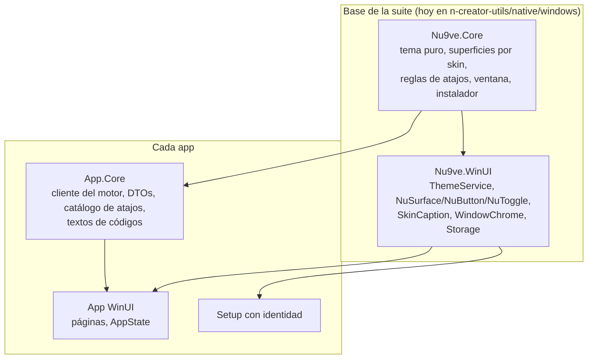

# Windows en la suite nu9ve: guía, base reutilizable y aprendizajes

Actualizado: 2026-11-09. Las **reglas** están en [apps de Windows v1](../contracts/windows-app-v1.md); esta página explica **cómo** cumplirlas, qué base de código ya existe y qué aprendimos en nove, curado y nüün. Nada de esto declara una app lista para producción.

## 1. Qué hay hoy

| App | Cliente Windows | Motor | Estado comprobado | Dónde |
| --- | --- | --- | --- | --- |
| **nove** | C#/WinUI 3 nativo | Rust por named pipe | 0.12.0.x por MSIX de desarrollo; host de fondo, avisos, broker, MCP; QA por UI Automation | `nove/apps/windows`, [A14–A19](../../../nove/docs/decisions.md) |
| **curado** | Tauri + WebView2 | Rust (`audio-engine`) | Compila y pasa pruebas en Windows 11; NSIS y MSI generados; no escuchado en Windows | `curado/docs/WINDOWS.md` |
| **nüün** | C#/WinUI 3 nativo (**maqueta**) | Rust en migración ([`engine/`](../../engine/README.md)); Python en Mac | Shell, cinco skins, Ingreso/Flujos/Biblioteca/Ajustes/Acerca de con datos ficticios. El motor de Rust responde `recipe` y, en sólo lectura, los destinos y las tarjetas montadas de este PC (Biblioteca → Discos). Setup con forma; MSIX empaquetado sin firmar | [`native/windows`](../../native/windows/README.md) |

nüün en Windows **no** lee discos todavía: la capa de volúmenes (`media/volumes.py`) usa `diskutil`/DiskArbitration. La maqueta lo dice en la barra («Maqueta») y en Ajustes.

## 2. Stack y versiones

Las apps nativas de la suite en Windows usan **lo mismo que nove**, para que una pieza sirva en varias sin traducirla:

| Pieza | Versión fijada | Nota |
| --- | --- | --- |
| .NET | 10 (`net10.0-windows10.0.22000.0`) | `TreatWarningsAsErrors`, `Nullable` |
| Windows App SDK | 1.8.260921001 | `TitleBar`, `AppWindow`, `InputNonClientPointerSource` |
| Pruebas | xUnit 2.9.3, Test SDK 17.14.1 | sin UI; contrato contra el motor real donde corre |
| Mínimo | Windows 11 (22000) | Windows 10 no se promete |
| Apps web | Tauri 2 + WebView2 (curado) | mismo tema por variables CSS |

Un paquete nuevo se decide y se anota aquí antes de usarlo. Ni nüün ni nove dependen del Community Toolkit: las *settings cards* y los controles con skin son propios.

## 3. Capas reutilizables

| Capa | Qué tiene | Qué **no** tiene |
| --- | --- | --- |
| `Nu9ve.Core` | `ThemeColor`, `ThemeRoles` (port literal de Swift), `ThemeSkin` con medidas, `ThemePreferences` (formato común, validación por campo), `SurfaceChrome` (cómo dibuja cada skin un panel, botón, píldora, tarjeta), `ShortcutRules`, `Layout` (canaleta, encaje en monitor), `Treemap`, `InstallerArguments`, `WindowShapes` | Nada de WinUI ni del motor de ninguna app |
| `Nu9ve.WinUI` | `ThemeService` (roles → pinceles compartidos, alto contraste del sistema, Mica), controles con skin, franja de título de época, `WindowChrome` (esquinas DWM, botones del sistema teñidos), `Storage` configurable por app, constructores `UI.*`, animación de transferencia | Catálogos o rutas de una app |
| `App.Core` | Lo propio: transporte con su motor, DTOs tolerantes, maqueta, catálogo de atajos, textos de los códigos | UI |

- Las vistas **eligen un rol** (`SurfaceKind.Panel`, `TextRole.Heading`); el skin decide cómo se ve. Ningún `switch` de skin vive en una página ([tema §1](../contracts/nu9ve-theme-v1.md#1-tres-capas)).
- Regla de extracción ([tema §10](../contracts/nu9ve-theme-v1.md#10-implementación-compartida)): hoy hay **una** copia en C#. Cuando nove la adopte (segunda) y otra app nativa la use (tercera), se mueve a su propio repo o feed local. Ese repo y su versionado **siguen sin decidir**; mientras tanto, se copia con el comentario de origen.

## 4. Ventana y barra

- **`TitleBar` de Windows App SDK** con `ExtendsContentIntoTitleBar`. Los botones del sistema quedan a la derecha (minimizar, maximizar con Snap Layouts, cerrar); la app nunca los dibuja.
- La barra de nüün (marca, navegación, discos, acciones) va en `LeftHeader`, `Content` y `RightHeader`. Con un skin de época que lleva franja de título (Macintosh, Windows 9x), la barra baja a una segunda fila, igual que `SkinWindowBar` en Mac: la navegación no se lee sobre rayas ni sobre un degradado.
- **Franja de época** (`SkinCaption`) detrás de la `TitleBar`: degradado con el color del usuario (Windows 9x), rayas con caja blanca en el título (Macintosh), dintel (Gótico), regla de fósforo (Terminal). Los botones del sistema se tiñen para leerse encima (`WindowChrome.TintCaptionButtons`); en alto contraste se liberan.
- **Esquinas:** Cristal conserva las redondeadas de Windows 11; los skins de época piden `DWMWCP_DONOTROUND`. **Fondo:** Mica sólo en Cristal y con «Efectos de transparencia» activo; si no, canvas sólido.
- **Modos:** mismos tamaños que Mac en DIPs (440×700, 780×820, 1180×900), escalados por `RasterizationScale` y encajados en el área de trabajo del monitor. Compacto queda siempre encima, como en Mac.
- La barra cede por pasos con una regla pura probada (`TitleBarFit`): primero los discos, luego el subtítulo, luego las etiquetas de navegación (quedan iconos con nombre accesible).

## 5. Tema en WinUI

- `ThemeService.Install(Application.Resources)` registra pinceles `Nu.<rol>` y los mismos objetos bajo claves del sistema. Cambiar el color cambia `SolidColorBrush.Color`: todo se repinta sin reconstruir. Cambiar el skin lanza `Changed(skinChanged: true)` y la app reconstruye la vista actual (formas y fuentes).
- **Claves del sistema:** sobrescribir sólo `AccentFillColorDefaultBrush` no llega a los controles, porque sus plantillas resuelven dentro de `XamlControlsResources`. Hay que nombrar las claves propias del control (`SliderTrackValueFill`, `SliderThumbBackground`, `TextControlBorderBrushFocused`, `ToggleSwitchFillOn`…). Comprobado en la captura de Ajustes: el deslizador pasó del azul del sistema al ámbar.
- **Alto contraste:** mandan los colores del sistema (`UISettings.UIElementColor`). `AccessibilitySettings.HighContrastChanged` **no** se puede suscribir en una app de escritorio (0x80070490); el cambio llega por `UISettings.ColorValuesChanged`.
- **Tipografía por rol** con fuentes que todo Windows 11 tiene: Georgia (Cristal, la serif de Mac), Tahoma (Windows 9x), Lucida Console (Macintosh), Cascadia Mono (Terminal), Palatino Linotype (Gótico). Las OFL del contrato (Jersey 15, Pixelify Sans, UnifrakturMaguntia) siguen pendientes de empaquetar.
- **Vectores compartidos:** [`theme-vectors-v1.json`](../contracts/examples/theme-vectors-v1.json) tiene 110 casos (5 skins × 2 modos × 11 colores) con el hex de cada rol. C# los verifica; Swift y TypeScript deberían leer el mismo archivo.

## 6. Teclado

- Un catálogo por app (`ShortcutCatalog`) genera los `KeyboardAccelerator`, las tooltips «Título (Ctrl+K)», `AutomationProperties.AcceleratorKey` y el panel Ctrl+/. Las pruebas fallan si dos acciones activas a la vez comparten tecla o si una pisa una tecla del sistema (`ShortcutRules.Reserved`).
- `AccessKey` en la navegación: al pulsar Alt aparecen los KeyTips del sistema, que son la capa de Alt nativa ([interacción §3](../contracts/nu9ve-interaction-v1.md#3-badges-de-teclas)).
- La puntuación no tiene nombre en `VirtualKey`: coma 188, barra 191, barra invertida 220, corchetes 219/221.
- Un atajo de vista fuera de su vista dice «no disponible» en vez de no hacer nada ([interacción §7](../contracts/nu9ve-interaction-v1.md#7-respuesta-al-usar-una-tecla)).

## 7. Motor y contratos

| | nove | nüün |
| --- | --- | --- |
| Transporte | Frames JSON de hasta 1 MiB por named pipe con ACL del usuario | Una línea JSON por mensaje por stdin/stdout de `media rpc-serve` |
| Sobre | Propio | `{"ok": true, "data"}` / `{"ok": false, "error": {code, message}}` (`ProtocolBoundary`) |
| DTOs | Escritos a mano en Swift y C# | Lectura tolerante (`JsonNode`): un campo ausente toma un valor neutro |
| Pruebas | Contra el motor real en raíces temporales | Transporte con flujos en memoria; contrato real pendiente hasta portar volúmenes |

- La app de Windows **presenta y pide**; no recalcula planes, copias ni limpieza.
- Una maqueta (`FixtureEngine`) tiene la forma del motor real (copiada de `_snapshot`, `source_cards`/`card_hint` y `recipe`), usa nombres `-DEMO` y lo dice en pantalla. Nunca toca un disco.

## 8. Datos, QA y diagnóstico

- `Storage.Configure("<app>", "<APP>_QA_ROOT", development)`: con la variable, todo va bajo esa raíz; sin ella, Debug y Release usan carpetas separadas en `%LOCALAPPDATA%\<app>`. Variables por app: `NOVE_QA_ROOT`, `NUUN_QA_ROOT`; para curado se propone `CURADO_QA_ROOT`.
- Escrituras atómicas (temporal + `File.Move`). Un error antes de la primera ventana queda en `last-start-error.txt`; uno después, en `last-ui-error.txt`. No contienen datos del usuario.
- Scripts de `scripts/windows/`:

| Script | Para qué | Origen |
| --- | --- | --- |
| `qa-skins.ps1` | Cada skin × página (y compacto) con raíz de QA temporal; par de `--qa-skins` de Mac | nuevo |
| `capture-window.ps1` | Captura con `PrintWindow` (sirve con WinUI y ventanas tapadas) | nove |
| `ui-invoke.ps1` | Recorrer e invocar por UI Automation, el árbol de Narrador | nove |
| `make-icons.ps1` | `.ico` y logos del MSIX desde vectores, mismo dibujo que `media_icon.swift` | nove (escritor de .ico) |
| `package-msix.ps1` | `-NoSign` empaqueta y valida el manifiesto; `-Sign` firma con el certificado de desarrollo | nove |

## 9. Paquete e instalador con identidad

- **MSIX** por usuario, versión monotónica por build, datos sin virtualizar en `%LOCALAPPDATA%\<app>`. nüün usa la misma identidad que en Mac (`app.nu9ve.media`).
- **Setup propio**, opcional y junto al MSIX ([contrato §9](../contracts/windows-app-v1.md#instalador-con-identidad)). El de nüün (`NuunSetup.exe`):
  - Ventana sin marco recortada con `SetWindowRgn` en la **forma de la SD de su icono** (`WindowShapes.SdCard`), arrastre por la cabecera con `InputNonClientPointerSource` y − × propios a la derecha.
  - Un solo ornamento: los tres contactos de la tarjeta. Se viste con los cinco skins de la app.
  - Dice qué, dónde, tus datos, permisos y atribuciones **antes** de instalar.
  - Instala con `PackageManager.AddPackageByUriAsync`, con porcentaje real, Cancelar y errores traducidos (certificado no confiable, versión más nueva, app abierta, dependencia faltante).
  - Esc cancela o cierra; Enter es la acción principal.
  - `--quiet --package x.msix` devuelve códigos estables (0 instalado, 1 falló, 2 argumentos, 3 cancelado).
  - Sin paquete es una **demostración rotulada** y no escribe nada en el sistema.
- Cada app elige su forma según su identidad ([tema §7](../contracts/nu9ve-theme-v1.md#7-identidad-de-cada-app)), sin marcas protegidas. Propuestas por decidir: nove con la vela latina o la rosa de los vientos; curado con un disco o un cassette; kyu con el visor de una cámara.
- Tauri (curado) usa NSIS: icono, cabecera, barra lateral, idiomas y plantilla propia. Ver [curado/docs/SUITE-WINDOWS.md](../../../curado/docs/SUITE-WINDOWS.md).

## 10. Aprendizajes con evidencia

| Problema observado | Causa | Regla |
| --- | --- | --- |
| La app moría al abrir (`TypeInitializationException`) | `ThemeService.Current` se creaba antes que las tablas estáticas declaradas después | Singleton perezoso (`current ??= new()`); nada estático depende del orden de declaración |
| `Application.Resources` lanzaba `0x8000FFFF` | No existe todavía en el constructor de `App` | Instalar recursos en `OnLaunched`, antes de la primera ventana |
| `HighContrastChanged` lanzaba `0x80070490` | Requiere `CoreWindow` | Releer alto contraste en `UISettings.ColorValuesChanged` |
| Un botón quedaba con el aspecto del sistema | `Loaded` llegó antes de la plantilla dentro de un panel propio | Enlazar el cromo en `OnApplyTemplate`; aplicar texto y fuente aunque falte la plantilla |
| `NETSDK1152` al publicar | La biblioteca WinUI era autocontenida y con MSIX tooling | Sólo la app ejecutable es autocontenida |
| El `.csproj` no cargaba | `--quiet` dentro de un comentario XML | Sin `--` en comentarios XML |
| Deslizadores azules con tema ámbar | Las plantillas leen claves propias del control | Sobrescribir las claves por control, no sólo el acento |
| Las tarjetas elegidas eran elipses | Usaban el radio de cápsula de Cristal | Una tarjeta seleccionable es `Card`/`CardSelected`, con el radio del panel |
| Texto ilegible al presionar | El relleno presionado cambiaba sin recalcular el texto | Prueba de contraste por cada `SurfaceKind` × skin × modo × color (`SurfaceChromeTests`) |
| Barra propia con regiones de paso a mano (nove A15) | — | Usar `TitleBar` |
| Tareas huérfanas al desinstalar (nove A15) | Task Scheduler no se va con el MSIX | `StartupTask` del manifiesto, deshabilitado hasta Ajustes |
| `Invoke-CommandInDesktopPackage` sin entorno (nove) | No hereda variables | Probar el paquete instalado lanzando su exe por ruta con la variable de QA |
| Instalación «perdida» en `Packages\…\LocalCache` (curado) | Un agente empaquetado como MSIX virtualiza `AppData` de sus hijos | Construir desde el agente; **instalar a mano** desde el Explorador |
| CRLF rompía el formateo (curado) | `core.autocrlf=true` | `.gitattributes` con LF |
| Python colgado antes de cargar numpy (curado) | Un hilo bloqueado en stdin síncrono | El worker vigila el proceso padre, no stdin |
| Enlaces a otros repos rotos en Windows | Rutas relativas pensadas para la disposición de carpetas de Mac (`../../../../ai/nove`) | Nombrar el repo y la ruta dentro de él (`nove: docs/decisions.md`); un enlace relativo vale sólo si ambos repos están en la misma carpeta |

## 11. Lista para una app nueva en Windows

1. Motor común y protocolo único; la UI presenta y pide ([contrato §0](../contracts/windows-app-v1.md#0-principio-dos-apps-nativas-un-producto)).
2. Referenciar `Nu9ve.Core` y `Nu9ve.WinUI` (o copiarlos con comentario de origen mientras no exista el paquete).
3. `Storage.Configure` con su carpeta y su `<APP>_QA_ROOT`; `UI.Shortcuts = Catalog.Get`.
4. Implementar el skin original, luego los tres comunes y luego el de contraste ([tema §5](../contracts/nu9ve-theme-v1.md#juego-de-skins-por-app)).
5. Catálogo de atajos con sus pruebas; `AccessKey` en la navegación.
6. Pruebas: vectores de tema, contraste por superficie y contrato contra el motor real.
7. QA: `qa-skins.ps1`, un recorrido con `ui-invoke.ps1` y revisión a mano de lo que no se automatiza (Narrador escuchado, escala 150 %, alto contraste).
8. MSIX con `-NoSign` para validar y Setup con su forma; firma y confianza del certificado son pasos explícitos.

## 12. Pendiente o no verificado

- nüün: motor en Windows (adaptador de volúmenes, runtime de Python empaquetado), contrato contra `media/service.py` real, firma e instalación del MSIX, Setup con un paquete real, recordar el marco por modo, tema de `TextBox`/`ComboBox` en skins de época, fuentes OFL, sonidos de tema, capa de badges con Ctrl/Shift, inglés.
- Alto contraste, escala 125/150/200 % y Narrador escuchado: **no** revisados a mano en nüün.
- Swift todavía no lee `theme-vectors-v1.json` (la app de Mac no se compiló desde esta máquina).
- Motor de nüün en Windows: ver [¿Pasar el motor a Rust?](rust-engine.md) para la opción de un motor común; MCP de cada app: [nu9ve-mcp-v1](../contracts/nu9ve-mcp-v1.md).
